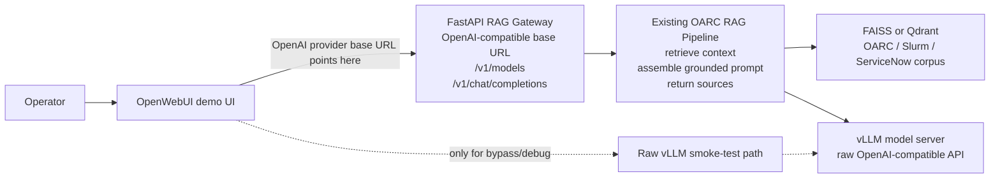

Title: OpenWebUI RAG Gateway Integration
Status: Done
Owner: agent-llm
Reviewers: n/a
Issues: n/a
Scope: repo-wide
Risk: low

# Context & Problem

Phase 3 of `project_docs/DESIGN.md` validates the OpenAI-compatible FastAPI RAG gateway endpoint
that OpenWebUI or another UI client should call. OpenWebUI must point at the RAG gateway, not
directly at vLLM, so user questions continue to pass through retrieval, prompt assembly, source
metadata, and the existing RAG telemetry path.

The scope was clarified after HPC testing: Phase 3 is complete for the backend/API contract.
Installing or deploying the OpenWebUI UI client is tracked separately as Phase 3b.

# Goals / Non-goals

Goals:
- Document how to configure OpenWebUI with the RAG gateway OpenAI-compatible base URL.
- Verify a client can list and call the `oarc-rag-v1` gateway model through the laptop-to-HPC
  tunnel.
- Preserve a separate raw-vLLM path for smoke testing and debugging only.
- Give operators a checklist for distinguishing RAG-backed answers from raw model answers.

Non-goals:
- Do not add auth, SSO, production deployment scripts, or service hardening.
- Do not replace vLLM, the RAG gateway, or the custom RAG pipeline.
- Do not build the final React/Next.js UI.
- Do not install or operate OpenWebUI in this backend/API verification scope.
- Do not put planning docs under `docs/`.

# Architecture Notes

OpenWebUI should be configured as an OpenAI-compatible client whose base URL points to the FastAPI
RAG gateway, for example `http://<gateway-host>:<gateway-port>/v1`. The gateway then owns
`/v1/models` and `/v1/chat/completions`, while vLLM remains the private backing model server used by
the RAG pipeline.



# Implementation Plan

- [x] Document the expected gateway base URL as `http://<gateway-host>:<gateway-port>/v1`.
- [x] Document the raw vLLM URL as bypass-only and label it clearly as non-RAG.
- [x] Add an OpenWebUI setup checklist: configure OpenAI-compatible provider, set API base URL to
  the RAG gateway, use the gateway API key field only if an operator has added one externally, and
  select `oarc-rag-v1`.
- [x] Add gateway smoke checks before OpenWebUI setup: `GET /health`, `GET /v1/models`, and a
  direct `POST /v1/chat/completions` request.
- [x] Add OpenWebUI verification steps using one known corpus-backed question.
- [x] Add operator checks for RAG-backed behavior: model alias is `oarc-rag-v1`, answers are
  grounded in the corpus, gateway logs show the request, and source metadata is present in API
  responses even if OpenWebUI does not render it.
- [x] Keep raw-vLLM smoke testing as a separate debug workflow with an explicit warning that it
  bypasses retrieval and sources.

# Verification Strategy

HPC sync and index preflight:

Use `rsync` without `--delete` when the HPC checkout already has generated assets such as a FAISS
index. This updates code, scripts, configs, and project docs while leaving the cluster index in
place:

```bash
rsync -az \
  --exclude '.git/' \
  --exclude '.venv/' \
  --exclude '__pycache__/' \
  --exclude '.pytest_cache/' \
  --exclude 'logs/' \
  --exclude 'runtime/' \
  --exclude 'vector_index/' \
  /Users/exequielpunzalan/Library/CloudStorage/OneDrive-RutgersUniversity/OARC/projects/oarc-ai-assistant/ \
  <hpc-login>:/scratch/$USER/oarc-ai-assistant/
```

Before rebuilding a FAISS index, inspect available repo scripts and confirm the existing target:

```bash
cd /scratch/$USER/oarc-ai-assistant
find scripts -iname '*faiss*' -o -iname '*index*' -o -iname '*ingest*'
ls -lh vector_index/faiss_amarel
```

The expected HPC target is `/scratch/$USER/oarc-ai-assistant/vector_index/faiss_amarel`. If that
index is present and Phase 3 only needs verification, do not rebuild it first. Rebuild or refresh
the index only when retrieval fails, sources are stale, or the corpus docs intentionally changed.

Manual verification completed for the backend/API path:
- vLLM started on `gpu-redhat` with local HF-format Llama 3.1 8B Instruct weights.
- The RAG gateway loaded the FAISS index and exposed `oarc-rag-v1`.
- `GET /health`, `GET /v1/models`, and `POST /v1/chat/completions` passed.
- Laptop SSH tunneling reached the live gateway at `http://127.0.0.1:8088`.
- Direct API responses included `rag_sources`.

Manual OpenWebUI UI verification is deferred to Phase 3b.

Static validation:
- Add tests that assert `project_docs/DESIGN.md` links this plan and includes the OpenWebUI diagram.
- Add tests that assert this plan file is unignored by `.gitignore`.

# Risks & Mitigations

- Risk: OpenWebUI is accidentally pointed at raw vLLM.
  - Mitigation: document gateway URL and raw-vLLM bypass URL separately, with explicit operator
    checks.
- Risk: OpenWebUI may not display custom `rag_sources` fields.
  - Mitigation: verify source metadata through direct API calls and treat OpenWebUI as demo UI only.
- Risk: network forwarding differs between macOS and HPC.
  - Mitigation: keep Phase 3 documentation URL-based and leave deployment scripts to Phase 4.

# Rollout & Telemetry

Roll out as documentation and verification. Existing FastAPI gateway and vLLM behavior remains
unchanged. Runtime telemetry continues through the current RAG pipeline; this phase adds no new
telemetry fields.

# Rollback Plan

Revert the Phase 3 documentation and plan file. OpenWebUI can be disconnected without affecting the
RAG gateway, vector stores, or vLLM server.

# Outcome

Phase 3 backend/API verification completed on HPC on 2026-05-15. The successful job was
`54243573` on `gpu022.amarel.rutgers.edu`. See
`project_docs/phase3_hpc_openwebui_report.md` for commands, results, warnings, and next-session
handoff notes.

# Decision Log

- 2026-04-27: Use OpenWebUI as an optional demo UI, not the owner of RAG logic.
- 2026-04-27: Configure OpenWebUI against the RAG gateway `/v1` base URL.
- 2026-04-27: Keep raw vLLM access only as a bypass/debug smoke-test path.
- 2026-05-15: Marked Phase 3 backend/API verification done after HPC pass and split actual
  OpenWebUI UI installation/configuration into Phase 3b.
