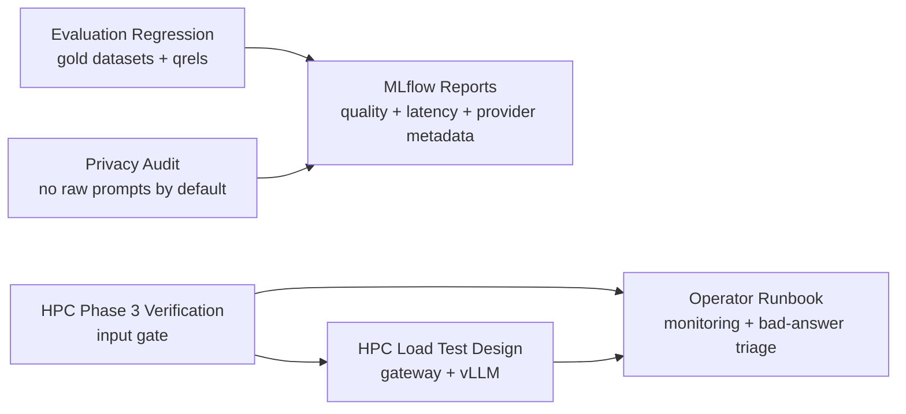

Title: Phase 5 Quality, Telemetry, and Multi-User Readiness
Status: Draft
Owner: agent-llm
Reviewers: n/a
Issues: n/a
Scope: repo-wide
Risk: medium

# Context & Problem

Phases 1 through 4 established an OpenAI-compatible RAG gateway, source metadata, service
hardening, and local OpenWebUI verification. Local Phase 3 passed with OpenWebUI calling
`oarc-rag-v1` through the gateway and receiving `rag_request_id` plus `rag_sources`.

HPC Phase 3 verification is still pending. Phase 5 planning can start now, but final operating
limits and deployment assumptions must remain provisional until
`scripts/deployment/hpc/run_phase3_openwebui_verification.sbatch` passes on the cluster.

# Goals / Non-goals

Goals:

- Add answer-quality and retrieval regression checks over `data/evaluation/gold/*`.
- Improve MLflow/reporting views for answer quality, retrieval quality, latency, and provider
  metadata.
- Define privacy controls for prompts, ServiceNow-derived content, user identifiers, and telemetry.
- Design multi-user and load readiness checks for the RAG gateway and vLLM path on HPC.
- Document an operator workflow for monitoring, bad-answer triage, FAISS/index refresh, and source
  metadata verification.

Non-goals:

- Do not build the final React/Next.js UI.
- Do not add SSO/auth rollout or production service daemonization.
- Do not change the public OpenAI-compatible gateway API.
- Do not hard-code GPU sizing, exact tunnel behavior, timeout tuning, model choice, or index policy
  before HPC Phase 3 completes.
- Do not put project planning docs under `docs/`.

# Design Overview



Phase 5 should separate generic readiness work from HPC-specific tuning. Evaluation harnesses,
reporting contracts, privacy tests, and runbook structure can be developed before the cluster result.
Final concurrency targets, GPU settings, endpoint lifetime, tunnel instructions, and timeout policy
must be filled in from the HPC Phase 3 logs.

# Implementation Plan

- [ ] Add regression evaluation entry points that run against `data/evaluation/gold/queries.jsonl`,
  `answers.jsonl`, and qrels without requiring an OpenWebUI browser session.
- [ ] Add report output that compares answer quality, retrieval quality, latency, backing model,
  vector store, corpus/index version, and provider metadata across runs.
- [ ] Add static and unit checks that telemetry remains sanitized: no raw prompts, no raw retrieved
  document text, and no user identifiers unless explicitly enabled.
- [ ] Design an HPC load-test workflow for concurrent `/v1/chat/completions` requests against the
  gateway, with result fields for request IDs, latency, status, and source metadata presence.
- [ ] Draft an operator runbook covering monitoring, bad-answer triage, FAISS/index refresh,
  source-metadata verification, and rollback to the last known-good index/config.
- [ ] After HPC Phase 3 passes, update this plan with observed model, index path, tunnel behavior,
  startup timing, latency, and recommended operating limits.

# Testing Strategy

- Unit-test the Phase 5 design link and plan allow-list behavior.
- Unit-test evaluation/report helpers with small fixtures instead of full model calls.
- Unit-test privacy sanitization with representative prompt, source, and user/session metadata.
- Add a dry-run load-test test that validates payload shape and result aggregation without starting
  vLLM.
- Keep full runtime validation gated on HPC Phase 3 output.

Run:

```bash
PYTEST_DISABLE_PLUGIN_AUTOLOAD=1 .venv/bin/pytest -q
PYTEST_DISABLE_PLUGIN_AUTOLOAD=1 .venv/bin/pytest \
  tests/unit/test_phase3_openwebui_plan.py \
  tests/unit/test_phase5_quality_ops_plan.py \
  -q
```

# Rollout & Telemetry

Roll out Phase 5 in two steps. First, land the plan, design link, and tests. Second, implement
evaluation, reporting, privacy, load-test, and runbook changes after the plan is reviewed and the
HPC Phase 3 result is available.

MLflow remains the reporting target. Any new telemetry must follow the existing sanitized telemetry
rule: hashes, IDs, metrics, source identifiers, and provider metadata are allowed; raw prompts, raw
answers, raw retrieved text, and user identifiers are not stored unless explicitly approved.

# Risks & Mitigations

- Risk: Phase 5 bakes in local-only assumptions before cluster verification.
  - Mitigation: treat HPC Phase 3 as an input gate for final operating limits.
- Risk: quality reports become hard to compare across model or index changes.
  - Mitigation: include model, vector store, corpus/index version, and provider metadata in reports.
- Risk: load testing stresses shared HPC resources unexpectedly.
  - Mitigation: start with dry-run/static tests and require operator-selected concurrency limits.
- Risk: telemetry leaks sensitive prompts or ServiceNow-derived content.
  - Mitigation: keep privacy tests focused on deny-by-default raw text handling.

# Rollback Plan

Revert the Phase 5 plan, DESIGN link, and plan tests. No runtime behavior, index, model, or
deployment state changes are introduced by this planning pass.

# Decision Log

- 2026-04-28: Created Phase 5 draft plan using the plan-first ops scope.
- 2026-04-28: Recorded that local Phase 3 OpenWebUI verification passed.
- 2026-04-28: Recorded HPC Phase 3 verification as the input gate for final operating limits and
  deployment assumptions.
