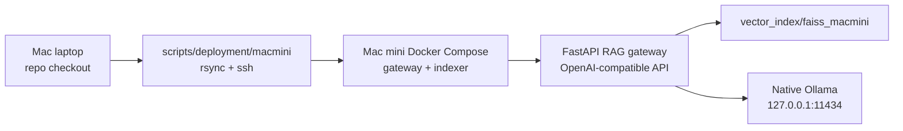

Title: Mac Mini Compose RAG deployment
Status: Executing
Owner: agent-llm
Reviewers: n/a
Issues: n/a
Scope: repo-wide
Risk: medium

# Context & Problem

The current RAG deployment path is optimized for local workstation testing and Slurm/HPC runs.
HPC is operationally slow to iterate on because authentication, scheduler interaction, tunnels,
and manual commands interrupt automated agent workflows. A Mac laptop can already deploy to the
Mac mini over SSH with Docker Compose, so this change adds a local-network deployment path for
rapid deploy-test-tune loops.

The Mac mini is an Apple Silicon host with limited RAM and disk compared with the HPC environment.
The first deployment must therefore avoid GPU/HPC-oriented runtimes such as vLLM or SGLang inside
Docker. The RAG gateway should run in Docker, while generation should use native Ollama on macOS so
the host can use Apple acceleration outside the Linux container.

# Goals / Non-goals

- Provide a Docker Compose deployment for the FastAPI RAG gateway on the Mac mini.
- Rebuild a Mac-mini-specific FAISS index in a one-shot Compose service.
- Use native Ollama's OpenAI-compatible API as the first local LLM backend.
- Keep raw ServiceNow task exports out of the Docker context, rsync deploy, and remote stack.
- Automate preflight, deploy, indexing, health, logs, and smoke checks from the laptop.
- Do not install or manage vLLM, SGLang, or llama-cpp-python in the gateway image.
- Do not expose the gateway beyond Mac mini loopback in this first deployment path.

# Design Overview



The Compose stack builds a Python 3.11 gateway image from locked base dependencies. Both gateway
and indexer share the same corpus, ServiceNow, embedding, and FAISS environment variables. The
indexer fails fast when the prepared ServiceNow JSONL is missing so the first mixed-corpus index
does not silently degrade to docs-only.

# Implementation Plan

- [x] Add Docker assets for the gateway/indexer image and Mac mini Compose stack.
- [x] Add Mac mini deploy, logs, health, preflight, index, and smoke scripts.
- [x] Add contract tests for privacy exclusions, env wiring, health checks, and script permissions.
- [x] Update architecture documentation for the new deployment path.
- [ ] Run a full remote smoke after Ollama is installed and serving on the Mac mini.

# Data Model & Migrations

No application schema changes are required. The deployment introduces a new FAISS artifact path:
`vector_index/faiss_macmini`. The artifact is generated on the Mac mini and preserved across rsync
deploys.

# Testing Strategy

- Unit/contract tests read the Docker, Compose, and shell-script files.
- Local gateway tests continue to validate the OpenAI-compatible API boundary with fakes.
- Remote smoke tests verify `/health`, `/v1/models`, one `/v1/chat/completions` call, provider
  health, returned `rag_sources`, and the absence of raw ServiceNow task JSON on the remote stack.

# Rollout & Telemetry

The service binds to `127.0.0.1:8088` on the Mac mini. MLflow and telemetry default off for this
path to minimize local disk writes and avoid accidental private-data artifacts during early tuning.
They can be re-enabled later through the server-only `.env`.

# Risks & Mitigations

- **Ollama unavailable:** preflight reports exact host commands to install, start, and pull the
  configured model.
- **Embedding/index drift:** gateway and indexer share the same Compose environment block.
- **Private data exposure:** deploy and Docker context exclude raw `docs/servicenow/task*.json`.
- **FAISS pickle trust:** `index.pkl` is generated locally and treated as trusted remote state.

# Security & Privacy

The remote `.env` is server-only and protected from rsync deletion. Raw ServiceNow exports and
cleaned JSON intermediates are excluded from deploy. The gateway stays loopback-bound on the Mac
mini. Host-generated runtime directories are protected from `rsync --delete`.

# Docs to Update

- `project_docs/ARCHITECTURE.md`
- `README.md`

# Rollback Plan

Run `APP=oarc-rag scripts/deployment/macmini/logs.sh gateway` to inspect failures, then stop the
stack on the Mac mini:

```bash
ssh mini 'cd ~/stacks/oarc-rag && docker compose -p oarc-rag -f compose.macmini.yaml down'
```

To remove generated local artifacts, delete `~/stacks/oarc-rag/vector_index/faiss_macmini` and
`~/stacks/oarc-rag/runtime` on the Mac mini after confirming no needed tuning artifacts remain.

# Decision Log

- 2026-05-28: Initial implementation plan created by agent-llm.
