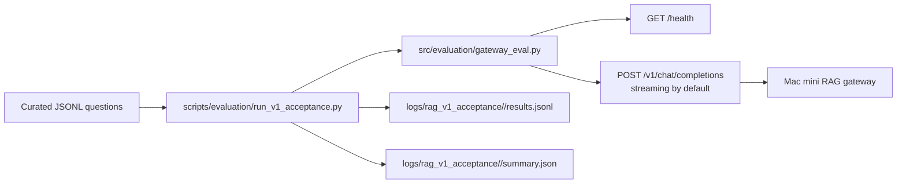

Title: Mac mini RAG v1 acceptance evaluation
Status: Done
Owner: agent-llm
Reviewers: n/a
Issues: n/a
Scope: repo-wide
Risk: medium

# Context & Problem

The Mac mini RAG gateway is operational through a laptop SSH tunnel and needs repeatable evidence
before promoting v1 to HPC private-tunnel testing. Manual browser checks prove the happy path, but
they do not leave structured pass/fail evidence across the required Slurm, Amarel, support, safety,
and optional attachment scenarios.

# Goals / Non-goals

- Add a non-interactive acceptance harness that calls the gateway's OpenAI-compatible chat endpoint.
- Record per-question JSONL evidence and a summary JSON under ignored runtime logs.
- Add automated gates for full acceptance pass/fail, p95 latency, p95 TTFT, and positive-question
  source coverage.
- Keep gateway metric and gate helpers reusable for future acceptance/evaluation suites.
- Keep full answers opt-in and avoid writing synthetic attachment text by default.
- Include an optional attachment scenario only when gateway health reports attachments enabled.
- Do not require OpenWebUI, read raw ServiceNow exports, mutate FAISS, or persist generated outputs.

# Design Overview

The CLI accepts either a gateway root URL or a full completions URL, normalizes it to
`/v1/chat/completions`, probes `/health` for attachment capability, runs the curated questions, and
writes evidence under `logs/rag_v1_acceptance/<timestamp>/`. The reusable
`src/evaluation/gateway_eval.py` module owns URL normalization, streaming response parsing,
latency/TTFT/source-count metrics, and the automated gate summary so future evaluation workflows can
share the same gateway contract.

# Alternatives Considered

- Reuse the embedding bakeoff runner: rejected because it rebuilds indexes and evaluates model
  sweeps instead of testing the deployed gateway.
- Store acceptance questions under `docs/`: rejected because `docs/` is corpus material.
- Capture full answers by default: rejected because acceptance output is evidence, not public docs.

# Implementation Plan

- [x] Add unit tests for question loading, URL normalization, summaries, result shape, and
  attachment gating.
- [x] Add `src/evaluation/acceptance.py` for loader, HTTP runner, checks, output writing, and
  summary aggregation.
- [x] Add `src/evaluation/gateway_eval.py` for reusable gateway calls, streaming metrics, and
  automated gate summaries.
- [x] Add `scripts/evaluation/run_v1_acceptance.py` as the copy-paste runnable CLI wrapper.
- [x] Add `data/evaluation/acceptance/rag_v1_questions.jsonl` with the v1 curated question set.
- [x] Update README and architecture docs with the acceptance workflow.
- [x] Run local verification, security review, Mac mini health, and acceptance smoke.
- [ ] Run the full live acceptance set after the small smoke gate passes.

# Data Model & Migrations

No migrations. The question set is newline-delimited JSON with IDs, categories, questions, optional
topic/source hints, safety flags, required/forbidden answer terms, and optional synthetic attachment
metadata. Run outputs are generated artifacts under ignored `logs/`.

# Testing Strategy

Unit tests use fake HTTP sessions and temporary question files, including streaming TTFT/source
metric parsing and automated gate aggregation. Live validation runs
`scripts/deployment/macmini/health.sh`, then the acceptance harness with `--max-questions 3`, then
the full curated set when the smoke succeeds.

# Rollout & Telemetry

The harness is local/operator-run only. It does not log to MLflow directly and does not change the
gateway, model server, vector index, or UI. Operators use the summary JSON as one gate for deciding
whether to start HPC private-tunnel testing. Promotion is automated only when `promotion_ready=true`,
which currently means the full acceptance pass/fail gate, p95 latency gate, p95 TTFT gate, and
positive-source coverage gate all pass.

# Risks & Mitigations

- Small local model answers may miss wording checks: topic/source hint misses are manual-review
  signals, while only required terms and core safety/source criteria fail.
- Acceptance outputs may include generated support content: full-answer capture is off by default.
- Attachment testing could leak local files: the harness generates synthetic text in memory only.

# Security & Privacy

The harness records curated non-sensitive prompts, response metadata, source summaries, and answer
excerpts by default. It does not read raw ServiceNow exports or local private attachment files.
Synthetic attachment text is redacted from default artifacts; full answers require
`--include-full-answer`.

# Docs to Update

Update `README.md` and `project_docs/ARCHITECTURE.md` with commands, output locations, privacy
posture, and how this acceptance gate relates to HPC private-tunnel testing.

# Rollback Plan

Delete the acceptance module, wrapper, question set, tests, plan, and documentation additions. Any
generated `logs/rag_v1_acceptance/` directories can be removed without affecting runtime state.

# Decision Log

- 2026-05-28: Store curated acceptance questions under `data/evaluation/acceptance/`.
- 2026-05-28: Keep default output excerpt-only and full-answer capture opt-in.
- 2026-05-28: Full live acceptance was held because the three-question smoke run failed required
  Slurm command checks; use the smoke output as the next quality-improvement input.

# Outcome

The v1 acceptance harness, curated question set, tests, CLI wrapper, README guidance, and
architecture documentation are implemented. Local verification passed. A follow-up prompt and
safety pass added compact Slurm command hints for the small Mac mini model plus deterministic
refusals for raw tickets, secrets, and hidden prompts. The redeployed Mac mini gateway passed the
three-question smoke gate and the full 18-question v1 acceptance run. A reusable gateway evaluation
module now captures streaming TTFT/source metrics and automated promotion gates for this and future
acceptance suites.
