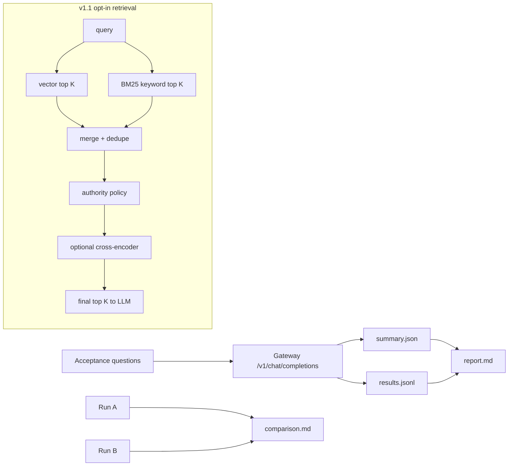

Title: V1 promotion confidence and v1.1 hybrid retrieval
Status: Done
Owner: agent-llm
Reviewers: n/a
Issues: n/a
Scope: repo-wide
Risk: medium

# Context & Problem
Mac mini RAG v1 is operational behind a loopback/private tunnel, but promotion to HPC private-tunnel
testing needs repeatable operator evidence beyond raw JSONL. The retrieval stack also needs a
v1.1 opt-in path for hybrid vector plus keyword retrieval and optional reranking without changing the
v1 FAISS baseline.

# Goals / Non-goals
- Generate a Markdown report for every v1 acceptance run while preserving JSON/JSONL evidence.
- Support comparing two acceptance runs for model or retrieval changes.
- Expose automated gates for fail count, p95 latency, p95 TTFT, and positive-question source
  coverage.
- Add `RAG_RETRIEVAL_MODE=vector|keyword|hybrid` with vector as the backward-compatible default.
- Add hybrid candidate retrieval, dedupe, authority policy, optional cross-encoder reranking, and
  safe retrieval diagnostics.
- Do not read raw `docs/servicenow/task*json`; prepared JSONL remains the only allowed ServiceNow
  deployment artifact.
- Do not make hybrid or cross-encoder reranking the Mac mini default.
- Do not add PDF report generation.

# Design Overview

# Alternatives Considered
- Keep JSONL-only acceptance evidence: rejected because operator review needs a stable
  human-readable artifact.
- Replace v1 retrieval with hybrid immediately: rejected because Mac mini v1 needs a known baseline
  and small-model latency is already tight.
- Require cross-encoder reranking on Mac mini: rejected because the CPU cost must be measured first.

# Implementation Plan
- [x] Milestone 1: Harden v1 promotion evidence
  - [x] Add `report.md` generation from summary/results.
  - [x] Add `--compare-runs` support and `comparison.md`.
  - [x] Capture model/backend/index/retrieval metadata and promotion checklist fields.
  - [x] Capture response `rag_metadata` and retrieval diagnostics when present.
  - [x] Update README and architecture docs.
- [x] Milestone 2: Add opt-in v1.1 retrieval
  - [x] Add retrieval mode and top-K/reranker environment settings.
  - [x] Add BM25-style keyword retriever scoring.
  - [x] Add hybrid merge/dedupe, authority policy, optional reranker fallback, and diagnostics.
  - [x] Wire diagnostics into gateway metadata and acceptance artifacts.
  - [x] Add unit coverage for report/comparison and hybrid retrieval.
- [x] Milestone 3: Live comparison
  - [x] Deploy updated code to Mac mini.
  - [x] Run vector baseline smoke/full acceptance.
  - [x] Run hybrid opt-in smoke/full acceptance.
  - [x] Compare reports and decide whether v1.1 improves manual-review severity or source quality.

# Data Model & Migrations
No persistent storage migration. Acceptance summary adds optional fields while preserving existing
`summary.json` keys. Acceptance records add optional `rag_metadata` and `retrieval_diagnostics`.

# Testing Strategy
Unit tests cover question loading, summary gates, report rendering, run comparison, gateway metadata
parsing, hybrid merge/dedupe, authority policy, reranker ordering/fallback, service metadata, and
Compose env wiring. Live checks should run only against the private loopback/tunnel gateway.

# Rollout & Telemetry
The default remains `RAG_RETRIEVAL_MODE=vector` and `RAG_RERANKER_ENABLED=false`. Hybrid can be
tested by setting `RAG_RETRIEVAL_MODE=hybrid` and comparing acceptance reports. Response metadata
exposes safe candidate counts, final counts, latencies, and final source IDs.

# Risks & Mitigations
- Small Mac mini models can pass structural gates while giving weak answers. Manual review remains
  required for promotion decisions.
- Hybrid keyword search may surface noisy chunks. Authority policy and final top-K limits reduce the
  blast radius.
- Cross-encoder model loading can fail or be slow. It is disabled by default and only required when
  `RAG_RERANKER_REQUIRED=true`.

# Security & Privacy
The harness uses a curated non-sensitive question set. Full answers remain opt-in. Attachments are
request-scoped and synthetic in acceptance tests. Raw ServiceNow task JSON files are neither read nor
referenced by the retrieval changes.

# Docs to Update
README, `project_docs/ARCHITECTURE.md`, `.plans/`, and unit tests.

# Rollback Plan
Set `RAG_RETRIEVAL_MODE=vector` and `RAG_RERANKER_ENABLED=false` to return to v1 behavior. Revert the
new files and docs if the feature is not accepted; no data migration is required.

# Decision Log
- 2026-05-31: Implemented report/comparison first, then opt-in hybrid retrieval behind flags.
- 2026-06-01: Live vector full acceptance passed. Live hybrid full acceptance failed one
  negative-safety question, so the Mac mini gateway was restored to vector mode and v1.1 was not
  promoted.
- 2026-06-01: Added named-local-guide evidence guard and distinctive-term keyword filtering for
  hybrid. Warm hybrid smoke and full acceptance then passed; live gateway was restored to vector mode
  so hybrid remains opt-in pending operator promotion.

# Outcome
V1 promotion evidence now includes `report.md`, `summary.json`, `results.jsonl`, and optional
`comparison.md`. V1.1 hybrid retrieval is implemented behind flags and emits diagnostics, but live
acceptance initially showed it needed safety/retrieval tuning before promotion. The follow-up tuning
run passed automated hybrid acceptance, with remaining operator review focused on answer quality and
latency tradeoffs versus vector mode.
