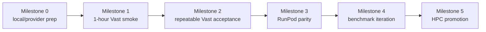

Title: Cloud GPU RAG iteration milestones
Status: Executing
Owner: agent-llm
Reviewers: n/a
Issues: n/a
Scope: repo-wide
Risk: medium

# Context & Problem

The RAG gateway, vLLM provider path, FAISS retrieval, and acceptance harness already provide the
core pieces needed to improve the OARC HPC chatbot. The current bottleneck is iteration speed:
manual `rsync`, Slurm submissions, tunnels, and cluster checks are too slow for daily retrieval,
prompt, model, and benchmark work.

Cloud GPUs should become a staging loop for automated iteration while the production target remains
the local HPC cluster. The implementation now supports RunPod, Vast, and existing SSH hosts from one
wrapper. No private user data, private ServiceNow tickets, secrets, or raw
`docs/servicenow/task*json` files may be uploaded to either provider.

# Goals / Non-goals

Goals:

- Prove the deployed path outside HPC: cloud GPU, vLLM, RAG gateway, FAISS retrieval, and
  `scripts/evaluation/run_v1_acceptance.py`.
- Define milestones for Vast smoke, Vast full acceptance, RunPod parity, benchmark iteration, and
  final HPC promotion.
- Keep success metrics objective: health checks, `oarc-rag-v1`, `rag_request_id`, `rag_sources`,
  acceptance pass/fail, p95 latency, and p95 TTFT.
- Use cloud providers only with public/non-sensitive corpus material and excerpt-only evidence by
  default.
- Minimize human-in-the-loop work to provider account/auth setup, candidate-question promotion, and
  manual review of rows explicitly flagged by the acceptance report.

Non-goals:

- Do not make Vast or RunPod the production deployment target.
- Do not expose the gateway publicly without an explicit auth/proxy layer.
- Do not run Research Pro in this milestone plan; that is tracked separately in
  `.plans/2026-07-17-hpc-rag-chatbot-research-pro.md`.
- Do not rebuild or tune the final HPC Slurm workflow before cloud acceptance is green.

# Design Overview



The cloud path mirrors the HPC runtime contract without using Slurm:

```text
cloud GPU instance -> vLLM /health -> RAG gateway /health -> /v1/models
  -> /v1/chat/completions -> FAISS retrieval -> acceptance artifacts
```

Access defaults to SSH tunneling. Public provider ports or managed tunnel URLs are allowed only for
short-lived testing and only after an auth/proxy decision is made.

# Milestones & Gates

## Milestone 0: Local and Provider Prep

- [x] Add `scripts/evaluation/run_cloud_acceptance.py` for RunPod, Vast, and existing SSH hosts.
- [x] Add allowlisted bundle creation with `.env*`, `docs/servicenow`, logs, model directories,
  generated results, and runtime directories blocked.
- [x] Add local public-index creation via `--build-index` with `SERVICE_NOW_DATA_PATH=/dev/null`.
- [x] Add `scripts/evaluation/draft_acceptance_questions.py` and the reviewed candidate suite
  `data/evaluation/acceptance/rag_v1_candidate_questions.jsonl`.
- [ ] Install the Vast CLI locally, then configure the API key outside the repo with
  `vastai set api-key`.
- [ ] Register the local SSH public key in Vast before creating instances.
- [x] Confirm local `uv`, `ssh`, `runpodctl`, RunPod CLI auth, and RunPod SSH key registration are
  available.
- [ ] Confirm local `vastai`, Vast CLI auth, and Vast SSH key registration are available.
- [x] Confirm a FAISS index exists for plumbing smoke, and rebuild a fresh public-corpus FAISS index
  before treating results as benchmark evidence.
- [x] Configure `runpodctl` outside the repo if RunPod is the selected provider.
- [x] Add targeted `--question-id`, cloud `--include-full-answer`, provider-specific cloud output
  roots, automatic report plots, and `cloud_run_ledger.{json,md}` artifacts for provider
  cost/resource tracking.

Progression gate: provider CLI auth works, SSH access is ready, and the public corpus/index decision
is documented in the run notes.

## Milestone 1: One-Hour Vast Smoke

- [ ] Launch one Vast GPU instance with a CUDA/PyTorch or vLLM-compatible image.
- [ ] Use an ungated/open instruct model by default: `Qwen/Qwen2.5-7B-Instruct`.
- [ ] Start vLLM on internal port `8000`.
- [ ] Start the existing FastAPI RAG gateway on internal port `8088`.
- [ ] Use SSH local port forwarding to reach the gateway from the laptop.
- [ ] Run direct checks for `/health`, `/v1/models`, and one chat completion.
- [ ] Run the three-question acceptance smoke through the tunnel.

Success metrics:

- vLLM `/health` returns healthy.
- Gateway `/health` returns healthy.
- `/v1/models` includes `oarc-rag-v1`.
- One direct completion returns answer text, `rag_request_id`, and non-empty `rag_sources`.
- `run_v1_acceptance.py --max-questions 3` has `fail_count == 0`.
- No positive source-required smoke question has zero sources.
- p95 latency is at or below `30000` ms.
- p95 TTFT is at or below `15000` ms.

Time-box decision: this milestone is the only milestone expected to fit in one hour, and only if the
GPU image, model download, dependencies, and index path do not consume most of the hour. If setup
exceeds the hour, record the blocker and continue Milestone 1 in the next cloud session rather than
weakening the success metrics.

## Milestone 2: Repeatable Vast Acceptance

- [ ] Build or copy a fresh public-corpus FAISS index; do not use raw ServiceNow task JSON.
- [ ] Run the full active acceptance set against the Vast gateway.
- [ ] Save `logs/rag_v1_acceptance/<timestamp>/results.jsonl`, `summary.json`, and `report.md`.
- [ ] Keep full answers disabled unless deliberately performing private review.
- [ ] Stop or terminate the Vast instance after evidence is captured.

Success metrics:

- `promotion_ready=true` in `summary.json`.
- Default evidence remains excerpt-only.
- `summary.json` records provider, model, index, retrieval mode, and gateway metadata.
- The provider instance is stopped/terminated.
- No secrets, API keys, raw prompts beyond curated acceptance questions, or private corpus files are
  committed or saved in repo-tracked files.

## Milestone 3: RunPod Parity

- [x] Configure `runpodctl` after a RunPod API key is available.
- [ ] Use a RunPod network volume for model and FAISS/index cache.
- [x] Repeat the Milestone 1 smoke against RunPod.
- [x] Repeat the Milestone 2 full acceptance against RunPod.
- [x] Capture one live assistant-ui screenshot against RunPod and terminate the pod.
- [x] Add explicit RunPod `--enable-ui-attachments` support for synthetic attachment tests.
- [x] Run a RunPod attachment-enabled synthetic marker test and capture a live UI screenshot.
- [x] Compare clean RunPod full acceptance artifacts against the previous full RunPod run; compare
  Vast artifacts only if Vast is reactivated.

Progression gate: RunPod produces a full acceptance run that is comparable to earlier RunPod
evidence, or the plan records a provider-specific blocker and reactivates Vast as the iteration
target.

## Milestone 4: Benchmark Iteration

- [x] Add cloud-run `--retrieval-mode` support so vector, keyword, and hybrid runs are recorded in
  plans and ledgers.
- [x] Compare `RAG_RETRIEVAL_MODE=vector` and `RAG_RETRIEVAL_MODE=hybrid`.
- [ ] Compare prompt variants while preserving the OpenAI-compatible gateway contract.
- [ ] Compare selected 7B/8B-class models before attempting larger models.
- [x] Add vector-mode local-guide fallback and targeted prompt cues for candidate access,
  Open OnDemand, scratch, job-array, owned-resource, login-node, and interactive `srun` rows.
- [x] Use run comparisons to track pass/fail, p95 latency, p95 TTFT, source counts, failed IDs,
  zero-source IDs, and manual-review IDs.
- [x] Expand non-blocking coverage with the candidate suite before promoting any rows beyond the
  active gate.
- [x] Promote candidate rows only after two clean cloud runs show stable expected topics, sources,
  and latency on the chosen model/retrieval configuration.
- [x] Generate and review a larger candidate dataset for benchmarking; reject the raw generated
  rows as the frozen suite when they skew toward low-value Slurm man-page fragments.
- [x] Add a frozen 91-question benchmark suite for RunPod model, GPU, prompt, retrieval, and
  context-window comparisons while keeping the 34-question gate as the blocking suite.
- [x] Run the 91-question benchmark suite on the current RunPod A40
  `Qwen/Qwen2.5-7B-Instruct` vector baseline with full-answer transcripts.
- [ ] Run `Qwen/Qwen2.5-7B-Instruct` on `NVIDIA GeForce RTX 4090` using the same 91-question
  suite, `--retrieval-mode vector`, and `--include-full-answer`; compare against A40 baseline
  `logs/rag_v1_acceptance/cloud/runpod/20260805T192820Z` on pass/fail, manual-review count,
  p95 latency, p95 TTFT, runtime, cost, and cost per executed question.
- [ ] If the 4090 run has no new failures and no worse manual-review queue than A40, promote the
  cheaper/faster 7B GPU as the default RunPod iteration GPU; otherwise keep A40 as the baseline.
- [ ] Run `Qwen/Qwen2.5-14B-Instruct` on `NVIDIA A40` first, because the current runner serves
  full-precision vLLM without quantization flags and a 24 GB 4090 may not fit the 14B model plus
  context. Compare against the selected 7B/GPU baseline on automated gates, manual-review answers,
  latency, TTFT, source quality, and cost per executed question.
- [ ] Run the 14B model on `NVIDIA L40S` and `NVIDIA A100 80GB PCIe` only after the A40 14B run is
  informative or blocked by memory/performance; pick the larger-model GPU by clean gates first,
  then by cost per executed question and p95 latency.
- [ ] Add a prompt-variant selector before A/B prompt runs, such as `--prompt-variant` or
  `RAG_PROMPT_VARIANT`, and record the selected variant in `summary.json` and
  `cloud_run_ledger.json`.
- [ ] Run prompt variants on the cheapest clean 7B/GPU baseline before larger-model reruns:
  `baseline-current`, `citation-strict-refusal` for stronger no-evidence behavior, and
  `concise-procedure` for shorter command/procedure answers. Promote a prompt only if it has zero
  automated failures and reduces manual-review issues without materially worsening p95 latency.
- [ ] Trial `Qwen/Qwen2.5-32B-Instruct` on `NVIDIA A100 80GB PCIe` after the 14B and prompt
  comparisons. Treat L40S for 32B as a separate quantization/serving experiment unless vLLM memory
  checks show the current full-precision command fits.

Milestone 4 deliverables:

- [x] Frozen benchmark data: 34-question blocking gate plus reviewed 91-question non-blocking
  comparison suite.
- [x] Baseline report: Qwen2.5-7B on RunPod A40 with full-answer transcripts, ledger, plots,
  pass/fail summary, and manual-review queue.
- [ ] GPU cost/runtime report: Qwen2.5-7B on RunPod 4090 versus the A40 baseline, including cost
  per executed question and default RunPod iteration GPU recommendation.
- [ ] Model-quality report: Qwen2.5-14B versus selected 7B baseline, with manual-review deltas and
  source-quality notes.
- [ ] Larger-GPU report: 14B on L40S/A100 if A40 is promising or blocked, with fit/performance/cost
  decision.
- [ ] Prompt-variant report: recorded prompt selector plus baseline/current, citation-strict, and
  concise-procedure comparisons.
- [ ] 32B trial report: Qwen2.5-32B on A100, including memory/serving outcome, quality deltas, and
  whether 32B is worth further optimization.
- [ ] Milestone 4 recommendation memo: chosen production-candidate config or explicit no-go,
  including model, GPU class, retrieval mode, prompt variant, context settings, attachment posture,
  expected cost/runtime, remaining manual-review risks, and next RunPod/HPC action.

Progression gate: the RunPod iteration loop produces a production-candidate configuration with
clean 34-question blocking gates, a clean or explicitly reviewed 91-question benchmark, acceptable
manual-review answers, recorded UI/attachment evidence, and a clear cost/latency tradeoff. HPC
equivalence is checked after that; it is not required before the RunPod model/GPU/prompt search is
finished.

Current status: RunPod parity has passed, including the attachment-enabled synthetic marker UI
screenshot. Milestone 4 benchmark iteration is active. Vector retrieval plus the FAISS-docstore
local-guide fallback is the current baseline: hybrid passed automated gates but introduced five
manual-review IDs. The candidate suite now has two clean full RunPod runs
(`logs/rag_v1_acceptance/cloud/runpod/20260804T212908Z` and
`logs/rag_v1_acceptance/cloud/runpod/20260805T011326Z`) with `16` pass, `0` fail, and no
manual-review IDs each. Those `16` candidate rows have been promoted into the active gate. The
expanded active RunPod gate
`logs/rag_v1_acceptance/cloud/runpod/20260805T012141Z` passed with `33` executed, `1` skipped
attachment row, `0` failures, no manual-review IDs, p95 latency `10594.62` ms, p95 TTFT
`1083.03` ms, and `promotion_ready=true`. The frozen 91-question benchmark suite at
`data/evaluation/acceptance/rag_v1_benchmark_questions.jsonl` now has a clean RunPod A40
full-answer baseline:
`logs/rag_v1_acceptance/cloud/runpod/20260805T192820Z` passed with `90` executed, `1` skipped
attachment row, `0` failures, `39` advisory manual-review IDs, p95 latency `10773.45` ms, p95
TTFT `861.33` ms, runtime `601.849` seconds, estimated cost `$0.0718145704`, and
`promotion_ready=true`. The next benchmark evidence steps are, in order: 4090 versus A40 for the
same Qwen2.5-7B run, Qwen2.5-14B on A40, 14B on L40S/A100 if useful, prompt-variant A/B support
and runs, and then one Qwen2.5-32B A100 trial. Vast setup, Vast comparison, and HPC promotion are
deferred while RunPod is the active iteration provider.

Written progress report:
`project_docs/reports/2026-08-04-cloud-rag-progress-report.md`. Update that report after each
cloud run with the run directory, ledger, cost, runtime, screenshot path when applicable, and
pass/fail result.

## Milestone 5: HPC Promotion

- [ ] Sync only code and approved public/prepared artifacts to the HPC checkout.
- [ ] Confirm the HPC FAISS index path and model path.
- [ ] Run `scripts/deployment/hpc/run_phase3_openwebui_verification.sbatch`.
- [ ] Confirm gateway health, vLLM health, `/v1/models`, direct completion, `rag_request_id`, and
  `rag_sources`.
- [ ] Run the acceptance harness through the HPC tunnel before any broader demo.

HPC promotion is the final production-port gate, not the current workstream. Do not resume this
milestone until the RunPod loop has selected a production-candidate model, GPU/serving assumptions,
retrieval mode, prompt variant, context settings, and UI/attachment posture. Promotion then proves
that the chosen RunPod configuration has an HPC-equivalent deployment for model, index, retrieval
mode, prompt/config environment variables, Slurm launch, tunnel, gateway health, and acceptance
results.

Current HPC status: intentionally deferred. A 2026-08-05 preflight reached the laptop network
boundary, found Cisco AnyConnect disconnected, and could not resolve `amarel.rutgers.edu`,
`amarel-new.hpc.rutgers.edu`, or `ondemand.hpc.rutgers.edu`. No files were synced, no ServiceNow
data was transferred, and no Slurm job was submitted. Resume this milestone only after the RunPod
benchmark loop has a production-candidate configuration and the Rutgers VPN is connected.

# Cost & Runtime Estimate

As of July 30, 2026, public provider pricing pages list RunPod RTX 4090 rates around `$0.34` to
`$0.69` per GPU-hour, RunPod A100 PCIe from about `$1.39` per GPU-hour, and Vast RTX 4090
marketplace offers from about `$0.13` per GPU-hour with a live median around `$0.36`. Prices change
with supply, cloud tier, storage, bandwidth, and network-volume choices; confirm the live quote
before launch.

Default 7B-class estimate:

- Three-question smoke: 30-60 minutes on first run, 10-25 minutes warm, about `$0.10-$0.70` on a
  4090-class GPU.
- Full active gate: 45-90 minutes on first run, 20-45 minutes warm, about `$0.20-$1.50` on a
  4090-class GPU. The current warm RunPod A40 expanded gate ran in `360.952` seconds and cost
  `$0.0741339814` by balance delta.
- Candidate suite: 45-120 minutes depending on selected question count and model throughput.
- Frozen 91-question benchmark: latest warm RunPod A40 vector baseline ran in `601.849` seconds
  and cost `$0.0718145704`; larger models and first-run model downloads should be budgeted above
  that.

Most first-run time is image boot, dependency install, model download, and local FAISS indexing.
Always destroy/terminate the instance after the run; stopped resources can still incur storage
charges.

# Testing Strategy

Local regression checks for the acceptance/gateway contract:

```bash
PYTEST_DISABLE_PLUGIN_AUTOLOAD=1 .venv/bin/pytest -q \
  tests/unit/test_cloud_acceptance.py \
  tests/unit/test_question_drafting.py \
  tests/unit/test_gateway_eval.py \
  tests/unit/test_rag_v1_acceptance.py \
  tests/unit/test_rag_gateway.py
```

Live provider checks:

```bash
.venv/bin/python scripts/evaluation/run_cloud_acceptance.py \
  --provider runpod \
  --build-index \
  --execute

.venv/bin/python scripts/evaluation/run_cloud_acceptance.py \
  --provider runpod \
  --build-index \
  --execute \
  --full-acceptance

.venv/bin/python scripts/evaluation/run_cloud_acceptance.py \
  --provider runpod \
  --build-index \
  --execute \
  --questions data/evaluation/acceptance/rag_v1_candidate_questions.jsonl \
  --full-acceptance

.venv/bin/python scripts/evaluation/run_cloud_acceptance.py \
  --provider runpod \
  --runpod-gpu "NVIDIA A40" \
  --execute \
  --retrieval-mode vector \
  --questions data/evaluation/acceptance/rag_v1_benchmark_questions.jsonl \
  --full-acceptance \
  --include-full-answer

.venv/bin/python scripts/evaluation/run_v1_acceptance.py \
  --base-url http://127.0.0.1:<local-gateway-port>/v1 \
  --max-questions 3 \
  --max-p95-latency-ms 30000 \
  --max-p95-ttft-ms 15000

.venv/bin/python scripts/evaluation/run_v1_acceptance.py \
  --base-url http://127.0.0.1:<local-gateway-port>/v1 \
  --max-p95-latency-ms 30000 \
  --max-p95-ttft-ms 15000
```

Comparison after two successful or informative runs:

```bash
.venv/bin/python scripts/evaluation/run_v1_acceptance.py \
  --compare-runs logs/rag_v1_acceptance/<run-a> logs/rag_v1_acceptance/<run-b>
```

# Rollout & Telemetry

Cloud runs are operator-run staging jobs. Generated artifacts stay under ignored `logs/`. Each run
must record provider, GPU type, model, retrieval mode, FAISS path, gateway URL shape, and known
failure notes in `report.md` or a companion run note. The cloud runner also writes
`cloud_run_ledger.json` and `cloud_run_ledger.md` with sanitized start/end balances, provider
resource ID, requested GPU or offer query, runtime, estimated cost, cleanup status, answer-capture
mode, question subset, and artifact paths. Cloud wrapper runs default to provider-specific roots
such as `logs/rag_v1_acceptance/cloud/runpod/<timestamp>/`; each report includes generated SVG
plots under its `plots/` directory.

Cloud acceptance results guide iteration; they do not replace final HPC validation. The HPC cluster
remains the deployment target because production behavior depends on Slurm, cluster filesystem
paths, local model staging, network policy, and support operations.

# Risks & Mitigations

- Risk: the one-hour window is consumed by first-time install or model download.
  - Mitigation: define Milestone 1 as a smoke gate, not a full benchmark gate.
- Risk: public cloud endpoint exposure leaks prompts or invites abuse.
  - Mitigation: use SSH tunnels by default and keep the gateway unexposed unless auth/proxy work is
    explicitly added.
- Risk: stale FAISS artifacts make benchmark conclusions invalid.
  - Mitigation: allow stale FAISS only for plumbing smoke, then rebuild public-corpus FAISS before
    benchmark runs.
- Risk: provider setup stores API keys in repo files or logs.
  - Mitigation: configure provider CLIs outside the repo and never commit env files or generated
    provider credentials.
- Risk: cloud results miss HPC-specific failures.
  - Mitigation: keep HPC promotion as a required final gate.

# Security & Privacy

Findings and controls:

- High: the gateway currently has no first-party API-key enforcement. Default access must be
  private SSH tunnel access. Public ports require a separate auth/proxy change.
- High: raw ServiceNow exports and private ticket data must not be copied to cloud providers.
  Prepared public/non-sensitive corpus material only.
- Medium: generated acceptance artifacts can contain support content. Keep excerpt-only capture by
  default and commit no generated logs.
- Medium: provider API keys must live in user/provider config or environment variables outside the
  repo.
- Low: managed provider tunnel URLs should be treated as short-lived and not published in docs,
  tickets, or committed artifacts.

# Docs to Update

- [x] Update `README.md` with the cloud loop entrypoints.
- [x] Update `project_docs/ARCHITECTURE.md` with cloud runner and question-drafting contracts.
- [x] Add `docs/cloud-gpu-rag-runbook.md` with commands, costs, transfer rules, and review
  guidance.
- [x] Update `docs/README.md` with the new runbook.

# Rollback Plan

Stop/terminate cloud instances, remove generated runtime artifacts under ignored `logs/` or cloud
scratch directories, and leave HPC deployment unchanged. No persistent data migration is introduced
by this plan.

# Decision Log

- 2026-07-17: Use Vast first because the API key is available.
- 2026-07-17: Keep RunPod as a parity provider after API key setup.
- 2026-07-17: Use an ungated/open 7B instruct model for the first smoke to avoid gated model
  access delays.
- 2026-07-17: Default to SSH tunnel access because gateway auth is not yet implemented.
- 2026-07-17: Treat one hour as enough for Milestone 1 smoke only, not the full milestone sequence.
- 2026-07-30: Implemented cloud acceptance wrapper, local public-index packaging, provider cleanup,
  alternate question suites, offline question drafting, and a reviewed candidate seed suite.
- 2026-07-30: Tried RunPod first. `runpodctl` auth, user balance lookup, and SSH key registration
  worked, and a fresh public FAISS index was built locally with ServiceNow disabled. Pod creation
  failed before transfer with RunPod `graphql error: Unauthorized`, so no cloud data was uploaded
  and no pod remained running.
- 2026-08-03: Added a separate RunPod write API key, registered the `runpodctl` SSH key, and
  completed a RunPod A40 three-question chatbot smoke. Final run
  `logs/rag_v1_acceptance/20260803T185404Z` passed all automated smoke gates with
  `promotion_ready=true`, p95 latency `2419.3` ms, p95 TTFT `291.95` ms, and four sources per
  answer. Provider cleanup deleted the Pod; post-run `runpodctl pod list` returned `[]`.
- 2026-08-04: Added full-answer forwarding, targeted question IDs, and automatic cloud run ledgers.
  Fixed advisory/manual-review cues for Amarel access, data transfer, support, Slurm debugging, and
  the prompt-injection safety sentinel. Final RunPod A40 full gate
  `logs/rag_v1_acceptance/20260804T042809Z` passed with `17` executed, `1` skipped attachment row,
  `0` failures, no manual-review IDs, p95 latency `14343.71` ms, p95 TTFT `347.87` ms, and
  `promotion_ready=true`. The runner deleted Pod `v6ozhirn5q5uhl`; post-run
  `runpodctl pod list` returned `[]`. The August 4 batch per-run ledgers summed to
  `$0.1789119778` at write time; the latest settled RunPod balance check showed `$9.6490003223`,
  or `$0.1810397445` spent from the `$9.8300400668` starting balance.
- 2026-08-04: Added assistant-ui, local and live RunPod screenshot evidence, explicit
  `--enable-ui-attachments` support, and the durable progress report
  `project_docs/reports/2026-08-04-cloud-rag-progress-report.md`.
- 2026-08-04: Completed the remaining RunPod parity evidence item with attachment-enabled run
  `logs/rag_v1_acceptance/cloud/runpod/20260804T202155Z` and screenshot
  `output/playwright/oarc-assistant-ui-runpod-attachment-live.png`. The synthetic marker row passed,
  the pod `xr8i9eeogjlg1w` was deleted, and `runpodctl pod list` returned `[]`.
- 2026-08-04: Ran the first Milestone 4 benchmarks. Hybrid full gate
  `logs/rag_v1_acceptance/cloud/runpod/20260804T202935Z` passed automated gates but introduced five
  manual-review IDs, so vector remains the baseline. Candidate-suite run
  `logs/rag_v1_acceptance/cloud/runpod/20260804T203326Z` passed `14` of `16` rows and identified
  `amarel_login_node_policy` and `slurm_interactive_srun` as failing candidate rows.
- 2026-08-04: Added vector-mode local-guide fallback from the FAISS docstore, tightened local
  prompt cues for candidate rows, and isolated cloud SSH known-hosts files per RunPod/Vast
  resource. Targeted RunPod reruns fixed the candidate failures and advisory rows. Final candidate
  suite `logs/rag_v1_acceptance/cloud/runpod/20260804T212908Z` passed `16` of `16` rows with no
  manual-review IDs. Final prior 18-question gate
  `logs/rag_v1_acceptance/cloud/runpod/20260804T213550Z` passed with `17` executed, `1` skipped
  attachment row, `0` failures, no manual-review IDs, p95 latency `14678.81` ms, p95 TTFT
  `637.36` ms, and `promotion_ready=true`.
- 2026-08-05: Completed the second clean candidate-suite stability run
  `logs/rag_v1_acceptance/cloud/runpod/20260805T011326Z` with `16` pass, `0` fail, no
  manual-review IDs, p95 latency `10338.82` ms, p95 TTFT `664.53` ms, runtime `265.054` seconds,
  and estimated cost `$0.0323954889`. Promoted all `16` candidate rows into the active acceptance
  gate, then ran expanded gate `logs/rag_v1_acceptance/cloud/runpod/20260805T012141Z` with `33`
  executed, `1` skipped attachment row, `0` failures, no manual-review IDs, p95 latency
  `10594.62` ms, p95 TTFT `1083.03` ms, runtime `360.952` seconds, and estimated cost
  `$0.0741339814`. Pod `8lnn3f09cihxvk` was deleted by the runner; post-run `runpodctl pod list`
  returned `[]` and `currentSpendPerHr` returned `0`.
- 2026-08-05: Started Milestone 5 HPC promotion preflight for the RunPod-proven configuration
  (`Qwen/Qwen2.5-7B-Instruct`, `vector_index/faiss_public`, vector retrieval, local-guide fallback
  enabled). The local Cisco AnyConnect client reported `Disconnected`; all Amarel and Open OnDemand
  hostnames failed DNS resolution from the laptop. The attempt stopped before sync or `sbatch`.
- 2026-08-05: Generated `data/evaluation/acceptance/rag_v1_candidate_questions.generated.jsonl`
  with 100 deterministic rows, reviewed it, and rejected the raw file as the frozen benchmark suite
  because it skewed toward low-value Slurm man-page/admin fragments. Added reviewed benchmark suite
  `data/evaluation/acceptance/rag_v1_benchmark_questions.jsonl` with 91 total rows: the 34-row
  active gate plus 57 reviewed additions across Slurm, Amarel access/storage, support/software
  policy, research-data services, negative safety, and the existing attachment marker.
- 2026-08-05: Ran the frozen 91-question RunPod A40
  `Qwen/Qwen2.5-7B-Instruct` vector benchmark baseline with full-answer transcripts. Final run
  `logs/rag_v1_acceptance/cloud/runpod/20260805T192820Z` passed with `90` executed, `1` skipped
  attachment row, `0` failures, `39` advisory manual-review IDs, p95 latency `10773.45` ms, p95
  TTFT `861.33` ms, runtime `601.849` seconds, estimated cost `$0.0718145704`, and
  `promotion_ready=true`. Pod `smckc97h8phopr` was deleted by the runner; post-run
  `runpodctl pod list` returned `[]` and `currentSpendPerHr` returned `0`.

# Provider References

- Vast CLI/API keys: <https://docs.vast.ai/cli/hello-world>
- Vast API key management: <https://docs.vast.ai/guides/reference/api-keys>
- Vast SSH access: <https://docs.vast.ai/guides/instances/connect/ssh>
- Vast networking and ports: <https://docs.vast.ai/guides/instances/connect/networking>
- Vast instance creation: <https://docs.vast.ai/cli/reference/create-instance>
- Vast live GPU pricing: <https://vast.ai/pricing>
- RunPod pod management: <https://docs.runpod.io/pods/manage-pods>
- RunPod GPU pricing: <https://www.runpod.io/pricing>
- RunPod network volumes: <https://docs.runpod.io/storage/network-volumes>
- vLLM on RunPod: <https://docs.vllm.ai/en/latest/deployment/frameworks/runpod/>
