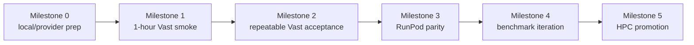

Title: Cloud GPU RAG iteration milestones
Status: Executing
Owner: agent-llm
Reviewers: n/a
Issues: n/a
Scope: repo-wide
Risk: medium

# Context & Problem

The RAG gateway, vLLM provider path, FAISS retrieval, and acceptance harness already provide the
core pieces needed to improve the OARC HPC chatbot. The current bottleneck is iteration speed:
manual `rsync`, Slurm submissions, tunnels, and cluster checks are too slow for daily retrieval,
prompt, model, and benchmark work.

Cloud GPUs should become a staging loop for automated iteration while the production target remains
the local HPC cluster. The implementation now supports RunPod, Vast, and existing SSH hosts from one
wrapper. No private user data, private ServiceNow tickets, secrets, or raw
`docs/servicenow/task*json` files may be uploaded to either provider.

# Goals / Non-goals

Goals:

- Prove the deployed path outside HPC: cloud GPU, vLLM, RAG gateway, FAISS retrieval, and
  `scripts/evaluation/run_v1_acceptance.py`.
- Define milestones for Vast smoke, Vast full acceptance, RunPod parity, benchmark iteration, and
  final HPC promotion.
- Keep success metrics objective: health checks, `oarc-rag-v1`, `rag_request_id`, `rag_sources`,
  acceptance pass/fail, p95 latency, and p95 TTFT.
- Use cloud providers only with public/non-sensitive corpus material and excerpt-only evidence by
  default.
- Minimize human-in-the-loop work to provider account/auth setup, candidate-question promotion, and
  manual review of rows explicitly flagged by the acceptance report.

Non-goals:

- Do not make Vast or RunPod the production deployment target.
- Do not expose the gateway publicly without an explicit auth/proxy layer.
- Do not run Research Pro in this milestone plan; that is tracked separately in
  `.plans/2026-07-17-hpc-rag-chatbot-research-pro.md`.
- Do not rebuild or tune the final HPC Slurm workflow before cloud acceptance is green.

# Design Overview



The cloud path mirrors the HPC runtime contract without using Slurm:

```text
cloud GPU instance -> vLLM /health -> RAG gateway /health -> /v1/models
  -> /v1/chat/completions -> FAISS retrieval -> acceptance artifacts
```

Access defaults to SSH tunneling. Public provider ports or managed tunnel URLs are allowed only for
short-lived testing and only after an auth/proxy decision is made.

# Milestones & Gates

## Milestone 0: Local and Provider Prep

- [x] Add `scripts/evaluation/run_cloud_acceptance.py` for RunPod, Vast, and existing SSH hosts.
- [x] Add allowlisted bundle creation with `.env*`, `docs/servicenow`, logs, model directories,
  generated results, and runtime directories blocked.
- [x] Add local public-index creation via `--build-index` with `SERVICE_NOW_DATA_PATH=/dev/null`.
- [x] Add `scripts/evaluation/draft_acceptance_questions.py` and the reviewed candidate suite
  `data/evaluation/acceptance/rag_v1_candidate_questions.jsonl`.
- [ ] Install the Vast CLI locally, then configure the API key outside the repo with
  `vastai set api-key`.
- [ ] Register the local SSH public key in Vast before creating instances.
- [x] Confirm local `uv`, `ssh`, `runpodctl`, RunPod CLI auth, and RunPod SSH key registration are
  available.
- [ ] Confirm local `vastai`, Vast CLI auth, and Vast SSH key registration are available.
- [x] Confirm a FAISS index exists for plumbing smoke, and rebuild a fresh public-corpus FAISS index
  before treating results as benchmark evidence.
- [x] Configure `runpodctl` outside the repo if RunPod is the selected provider.

Progression gate: provider CLI auth works, SSH access is ready, and the public corpus/index decision
is documented in the run notes.

## Milestone 1: One-Hour Vast Smoke

- [ ] Launch one Vast GPU instance with a CUDA/PyTorch or vLLM-compatible image.
- [ ] Use an ungated/open instruct model by default: `Qwen/Qwen2.5-7B-Instruct`.
- [ ] Start vLLM on internal port `8000`.
- [ ] Start the existing FastAPI RAG gateway on internal port `8088`.
- [ ] Use SSH local port forwarding to reach the gateway from the laptop.
- [ ] Run direct checks for `/health`, `/v1/models`, and one chat completion.
- [ ] Run the three-question acceptance smoke through the tunnel.

Success metrics:

- vLLM `/health` returns healthy.
- Gateway `/health` returns healthy.
- `/v1/models` includes `oarc-rag-v1`.
- One direct completion returns answer text, `rag_request_id`, and non-empty `rag_sources`.
- `run_v1_acceptance.py --max-questions 3` has `fail_count == 0`.
- No positive source-required smoke question has zero sources.
- p95 latency is at or below `30000` ms.
- p95 TTFT is at or below `15000` ms.

Time-box decision: this milestone is the only milestone expected to fit in one hour, and only if the
GPU image, model download, dependencies, and index path do not consume most of the hour. If setup
exceeds the hour, record the blocker and continue Milestone 1 in the next cloud session rather than
weakening the success metrics.

## Milestone 2: Repeatable Vast Acceptance

- [ ] Build or copy a fresh public-corpus FAISS index; do not use raw ServiceNow task JSON.
- [ ] Run the full 18-question acceptance set against the Vast gateway.
- [ ] Save `logs/rag_v1_acceptance/<timestamp>/results.jsonl`, `summary.json`, and `report.md`.
- [ ] Keep full answers disabled unless deliberately performing private review.
- [ ] Stop or terminate the Vast instance after evidence is captured.

Success metrics:

- `promotion_ready=true` in `summary.json`.
- Default evidence remains excerpt-only.
- `summary.json` records provider, model, index, retrieval mode, and gateway metadata.
- The provider instance is stopped/terminated.
- No secrets, API keys, raw prompts beyond curated acceptance questions, or private corpus files are
  committed or saved in repo-tracked files.

## Milestone 3: RunPod Parity

- [x] Configure `runpodctl` after a RunPod API key is available.
- [ ] Use a RunPod network volume for model and FAISS/index cache.
- [x] Repeat the Milestone 1 smoke against RunPod.
- [ ] Repeat the Milestone 2 full acceptance against RunPod.
- [ ] Compare Vast and RunPod run artifacts with `--compare-runs`.

Progression gate: RunPod produces a full acceptance run that is comparable to the successful Vast
run, or the plan records a provider-specific blocker and keeps Vast as the active iteration target.

## Milestone 4: Benchmark Iteration

- [ ] Compare `RAG_RETRIEVAL_MODE=vector` and `RAG_RETRIEVAL_MODE=hybrid`.
- [ ] Compare prompt variants while preserving the OpenAI-compatible gateway contract.
- [ ] Compare selected 7B/8B-class models before attempting larger models.
- [ ] Use run comparisons to track pass/fail, p95 latency, p95 TTFT, source counts, failed IDs,
  zero-source IDs, and manual-review IDs.

Progression gate: at least one cloud full acceptance run passes, manual-review answers are
acceptable, and the chosen model/retrieval/prompt configuration has an HPC-equivalent deployment
path.

## Milestone 5: HPC Promotion

- [ ] Sync only code and approved public/prepared artifacts to the HPC checkout.
- [ ] Confirm the HPC FAISS index path and model path.
- [ ] Run `scripts/deployment/hpc/run_phase3_openwebui_verification.sbatch`.
- [ ] Confirm gateway health, vLLM health, `/v1/models`, direct completion, `rag_request_id`, and
  `rag_sources`.
- [ ] Run the acceptance harness through the HPC tunnel before any broader demo.

HPC promotion is allowed only when a cloud full acceptance run passes, manual-review answers are
acceptable, the Research Pro rubric reveals no missing critical categories, and the chosen cloud
configuration has an HPC equivalent for model, index, retrieval mode, and gateway environment
variables.

# Cost & Runtime Estimate

As of July 30, 2026, public provider pricing pages list RunPod RTX 4090 rates around `$0.34` to
`$0.69` per GPU-hour, RunPod A100 PCIe from about `$1.39` per GPU-hour, and Vast RTX 4090
marketplace offers from about `$0.13` per GPU-hour with a live median around `$0.36`. Prices change
with supply, cloud tier, storage, bandwidth, and network-volume choices; confirm the live quote
before launch.

Default 7B-class estimate:

- Three-question smoke: 30-60 minutes on first run, 10-25 minutes warm, about `$0.10-$0.70` on a
  4090-class GPU.
- Full 18-question gate: 45-90 minutes on first run, 20-45 minutes warm, about `$0.20-$1.50` on a
  4090-class GPU.
- Candidate suite: 45-120 minutes depending on selected question count and model throughput.

Most first-run time is image boot, dependency install, model download, and local FAISS indexing.
Always destroy/terminate the instance after the run; stopped resources can still incur storage
charges.

# Testing Strategy

Local regression checks for the acceptance/gateway contract:

```bash
PYTEST_DISABLE_PLUGIN_AUTOLOAD=1 .venv/bin/pytest -q \
  tests/unit/test_cloud_acceptance.py \
  tests/unit/test_question_drafting.py \
  tests/unit/test_gateway_eval.py \
  tests/unit/test_rag_v1_acceptance.py \
  tests/unit/test_rag_gateway.py
```

Live provider checks:

```bash
.venv/bin/python scripts/evaluation/run_cloud_acceptance.py \
  --provider runpod \
  --build-index \
  --execute

.venv/bin/python scripts/evaluation/run_cloud_acceptance.py \
  --provider runpod \
  --build-index \
  --execute \
  --full-acceptance

.venv/bin/python scripts/evaluation/run_cloud_acceptance.py \
  --provider runpod \
  --build-index \
  --execute \
  --questions data/evaluation/acceptance/rag_v1_candidate_questions.jsonl \
  --full-acceptance

.venv/bin/python scripts/evaluation/run_v1_acceptance.py \
  --base-url http://127.0.0.1:<local-gateway-port>/v1 \
  --max-questions 3 \
  --max-p95-latency-ms 30000 \
  --max-p95-ttft-ms 15000

.venv/bin/python scripts/evaluation/run_v1_acceptance.py \
  --base-url http://127.0.0.1:<local-gateway-port>/v1 \
  --max-p95-latency-ms 30000 \
  --max-p95-ttft-ms 15000
```

Comparison after two successful or informative runs:

```bash
.venv/bin/python scripts/evaluation/run_v1_acceptance.py \
  --compare-runs logs/rag_v1_acceptance/<run-a> logs/rag_v1_acceptance/<run-b>
```

# Rollout & Telemetry

Cloud runs are operator-run staging jobs. Generated artifacts stay under ignored `logs/`. Each run
must record provider, GPU type, model, retrieval mode, FAISS path, gateway URL shape, and known
failure notes in `report.md` or a companion run note.

Cloud acceptance results guide iteration; they do not replace final HPC validation. The HPC cluster
remains the deployment target because production behavior depends on Slurm, cluster filesystem
paths, local model staging, network policy, and support operations.

# Risks & Mitigations

- Risk: the one-hour window is consumed by first-time install or model download.
  - Mitigation: define Milestone 1 as a smoke gate, not a full benchmark gate.
- Risk: public cloud endpoint exposure leaks prompts or invites abuse.
  - Mitigation: use SSH tunnels by default and keep the gateway unexposed unless auth/proxy work is
    explicitly added.
- Risk: stale FAISS artifacts make benchmark conclusions invalid.
  - Mitigation: allow stale FAISS only for plumbing smoke, then rebuild public-corpus FAISS before
    benchmark runs.
- Risk: provider setup stores API keys in repo files or logs.
  - Mitigation: configure provider CLIs outside the repo and never commit env files or generated
    provider credentials.
- Risk: cloud results miss HPC-specific failures.
  - Mitigation: keep HPC promotion as a required final gate.

# Security & Privacy

Findings and controls:

- High: the gateway currently has no first-party API-key enforcement. Default access must be
  private SSH tunnel access. Public ports require a separate auth/proxy change.
- High: raw ServiceNow exports and private ticket data must not be copied to cloud providers.
  Prepared public/non-sensitive corpus material only.
- Medium: generated acceptance artifacts can contain support content. Keep excerpt-only capture by
  default and commit no generated logs.
- Medium: provider API keys must live in user/provider config or environment variables outside the
  repo.
- Low: managed provider tunnel URLs should be treated as short-lived and not published in docs,
  tickets, or committed artifacts.

# Docs to Update

- [x] Update `README.md` with the cloud loop entrypoints.
- [x] Update `project_docs/ARCHITECTURE.md` with cloud runner and question-drafting contracts.
- [x] Add `docs/cloud-gpu-rag-runbook.md` with commands, costs, transfer rules, and review
  guidance.
- [x] Update `docs/README.md` with the new runbook.

# Rollback Plan

Stop/terminate cloud instances, remove generated runtime artifacts under ignored `logs/` or cloud
scratch directories, and leave HPC deployment unchanged. No persistent data migration is introduced
by this plan.

# Decision Log

- 2026-07-17: Use Vast first because the API key is available.
- 2026-07-17: Keep RunPod as a parity provider after API key setup.
- 2026-07-17: Use an ungated/open 7B instruct model for the first smoke to avoid gated model
  access delays.
- 2026-07-17: Default to SSH tunnel access because gateway auth is not yet implemented.
- 2026-07-17: Treat one hour as enough for Milestone 1 smoke only, not the full milestone sequence.
- 2026-07-30: Implemented cloud acceptance wrapper, local public-index packaging, provider cleanup,
  alternate question suites, offline question drafting, and a reviewed candidate seed suite.
- 2026-07-30: Tried RunPod first. `runpodctl` auth, user balance lookup, and SSH key registration
  worked, and a fresh public FAISS index was built locally with ServiceNow disabled. Pod creation
  failed before transfer with RunPod `graphql error: Unauthorized`, so no cloud data was uploaded
  and no pod remained running.
- 2026-08-03: Added a separate RunPod write API key, registered the `runpodctl` SSH key, and
  completed a RunPod A40 three-question chatbot smoke. Final run
  `logs/rag_v1_acceptance/20260803T185404Z` passed all automated smoke gates with
  `promotion_ready=true`, p95 latency `2419.3` ms, p95 TTFT `291.95` ms, and four sources per
  answer. Provider cleanup deleted the Pod; post-run `runpodctl pod list` returned `[]`.

# Provider References

- Vast CLI/API keys: <https://docs.vast.ai/cli/hello-world>
- Vast API key management: <https://docs.vast.ai/guides/reference/api-keys>
- Vast SSH access: <https://docs.vast.ai/guides/instances/connect/ssh>
- Vast networking and ports: <https://docs.vast.ai/guides/instances/connect/networking>
- Vast instance creation: <https://docs.vast.ai/cli/reference/create-instance>
- Vast live GPU pricing: <https://vast.ai/pricing>
- RunPod pod management: <https://docs.runpod.io/pods/manage-pods>
- RunPod GPU pricing: <https://www.runpod.io/pricing>
- RunPod network volumes: <https://docs.runpod.io/storage/network-volumes>
- vLLM on RunPod: <https://docs.vllm.ai/en/latest/deployment/frameworks/runpod/>
