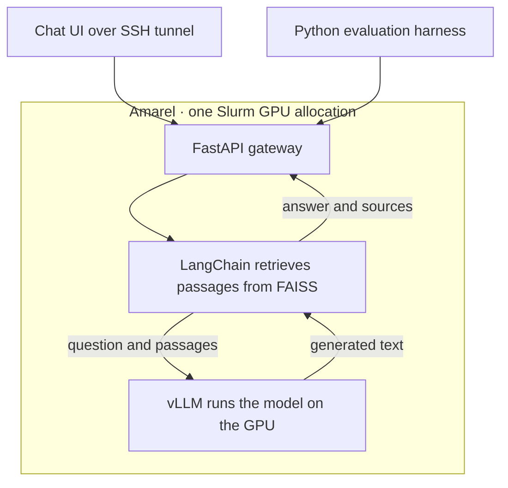

# OARC AI Assistant

The assistant answers questions about Rutgers’ Amarel cluster and cites the OARC and Slurm
documentation it retrieves. For example, a researcher can ask “How do I submit a Slurm batch job?”

**Validation status.** The Amarel gateway returned a sourced answer using Llama 3.1 8B Instruct.
On RunPod, Qwen2.5-7B-Instruct passed all 100 automated checks in the August reference benchmark.
The harness flagged 49 answers for human review. Multi-user capacity still needs validation.
[Amarel verification](project_docs/phase3_hpc_openwebui_report.md) · [Benchmark report][benchmark]

## Architecture



## HPC operations

Start with the [verified Slurm procedure][slurm]. It requires a prepared FAISS index, a model
directory, and one GPU. The [vLLM runbook](docs/hpc-vllm-runbook.md) covers a separately scheduled
model server. The 7B model ran a 90-question comparison on a 24 GB RTX 4090 and the 100-question
reference on a 48 GB A40. Production sizing depends on context length and simultaneous requests. [GPU hardware and sizing][hardware]

## Repository tree

```text
.
├── src/                    Chat service (rag/) and evaluation harness (evaluation/)
├── scripts/deployment/hpc/ Slurm launchers and verification jobs
├── docs/                   Retrieval corpus and operator runbooks
└── project_docs/           Architecture and benchmark reports
```

[slurm]: project_docs/phase3_hpc_openwebui_report.md#working-submission
[benchmark]: project_docs/reports/2026-08-07-m4-stakeholder-evaluation-report.md
[hardware]: project_docs/ARCHITECTURE.md#gpu-hardware-and-sizing
