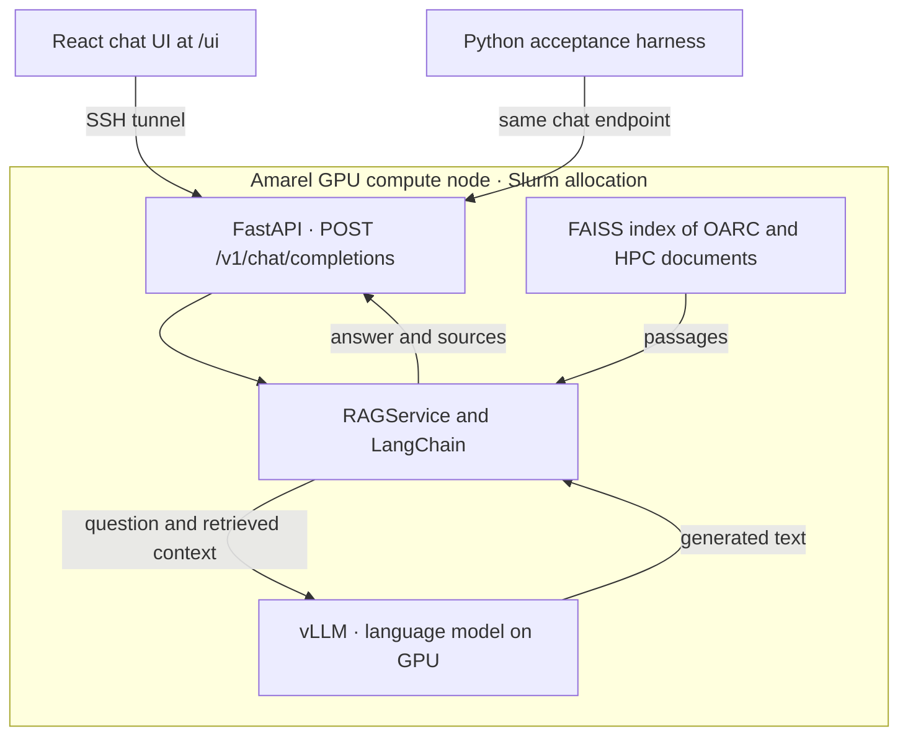

# RAG System for OARC Documentation

The OARC AI Assistant answers questions about the Amarel cluster using retrieval-augmented
generation over Rutgers OARC guides, Slurm documentation, and other HPC references.

## Architecture

On Amarel, Slurm allocates a GPU compute node. The verified job runs the FastAPI gateway and
vLLM in the same allocation. The browser connects to the gateway over an SSH tunnel. LangChain
retrieves passages from the FAISS index and sends the question and passages to vLLM. The GPU runs
the language model. The gateway returns the answer with its sources.



The Amarel backend verification used **Llama 3.1 8B Instruct**. The RunPod reference benchmark
used **Qwen2.5-7B-Instruct**. Both used vLLM for inference. Clients address the complete RAG
service as `oarc-rag-v1`. The Python harness exercises the same chat endpoint as the UI and checks
source evidence, expected answer content, refusals, and latency.

## GPUs used

Capacities are nominal VRAM per GPU. Each row describes a recorded project run.

| Environment | NVIDIA GPU | VRAM and memory | Architecture | Recorded use |
| --- | --- | --- | --- | --- |
| RunPod | A40 | 48 GB GDDR6 ECC | Ampere | 100-question 7B reference and 14B comparison |
| RunPod | GeForce RTX 4090 | 24 GB GDDR6X | Ada Lovelace | 90-question 7B comparison |
| RunPod | A100 PCIe | 80 GB HBM2e | Ampere | Targeted 32B and 7B runs |
| RunPod | H100 PCIe | 80 GB HBM2e | Hopper | 100-question 7B RAG versus raw-model comparison |
| Amarel | A100 PCIe | 40 GB HBM2 | Ampere | Earlier chat and evaluation jobs on `gpu027` |
| Amarel | L40S | 48 GB GDDR6 ECC | Ada Lovelace | Earlier inference smoke test on `gpuk008` |

The Amarel vLLM verification job (`54243573`) requested one GPU on `gpu-redhat` and ran on
`gpu022`. Its report identifies the model and confirms a response with sources. The GPU model and
VRAM for that particular allocation are unknown. The 32 GB in its Slurm script is host RAM.

The [Amarel verification report](project_docs/phase3_hpc_openwebui_report.md) records the job.
The [August RunPod benchmark][benchmark] covers the A40 and RTX 4090. Subsequent RunPod ledgers
record the A100 80 GB tests on August 24 and September 1 and the H100 test on September 1, 2026.
The Amarel device names come from the saved output for jobs `46711800` and `46693155`.

NVIDIA lists the memory and compute features for the [A40][a40], [RTX 4090][4090],
[A100][a100], [H100 PCIe][h100], and [L40S][l40s]. For example, the A100 uses high-bandwidth
memory, the L40S has fourth-generation Tensor Cores, and the H100 adds a Transformer Engine.

[benchmark]: project_docs/reports/2026-08-07-m4-stakeholder-evaluation-report.md
[a40]: https://www.nvidia.com/en-us/data-center/a40/
[4090]: https://www.nvidia.com/en-us/geforce/graphics-cards/40-series/rtx-4090/
[a100]: https://www.nvidia.com/en-us/data-center/a100/
[h100]: https://developer.nvidia.com/blog/nvidia-hopper-architecture-in-depth/
[l40s]: https://www.nvidia.com/en-us/data-center/l40s/

## Repository tree

```text
.
├── src/
│   ├── rag/
│   │   ├── api.py              FastAPI routes and streaming responses
│   │   ├── service.py          Request handling and source metadata
│   │   ├── rag_pipeline.py     Retrieval, prompt assembly, and generation
│   │   ├── ui_app/             React chat client
│   │   └── ui_static/          Built assets served by FastAPI
│   └── evaluation/             Acceptance checks and embedding benchmarks
├── scripts/
│   ├── rag/                    Corpus import and index construction
│   ├── deployment/             Local, Mac mini, and HPC launchers
│   └── evaluation/             Evaluation entry points
├── configs/                    Model, source, and evaluation settings
├── data/evaluation/            Benchmark questions and reference answers
├── docs/                       Retrieval corpus and operator runbooks
├── project_docs/               Architecture, design notes, and reports
└── tests/unit/                 Python unit and contract tests
```

## Running and verifying the HPC service

The [verified Slurm procedure](project_docs/phase3_hpc_openwebui_report.md#working-submission)
starts the gateway and vLLM together using a prepared FAISS index and model directory.
The [vLLM runbook](docs/hpc-vllm-runbook.md) covers a separately scheduled model server.
For component details, see the [architecture guide](project_docs/ARCHITECTURE.md).
