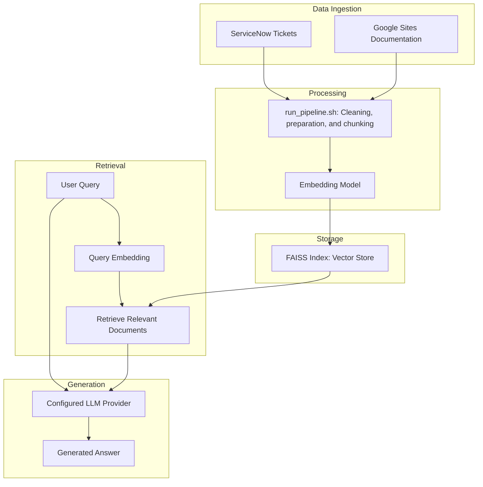
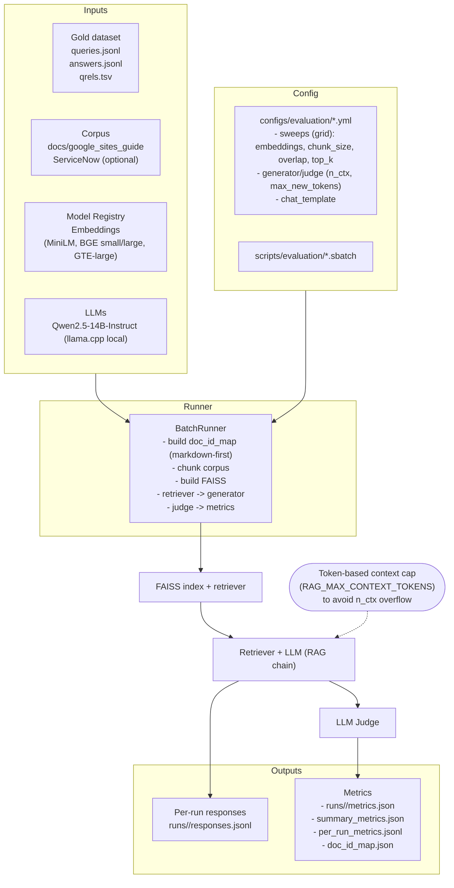
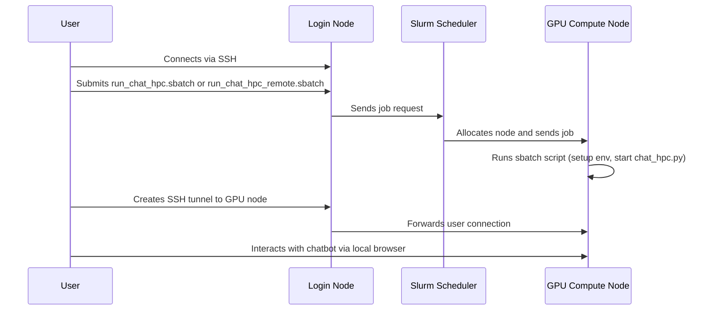

# RAG System for OARC Documentation

This project implements a Retrieval-Augmented Generation (RAG) system to answer questions about the
Amarel cluster from OARC, Slurm, and prepared ServiceNow-derived sources. The canonical current
architecture guide is [`project_docs/ARCHITECTURE.md`](project_docs/ARCHITECTURE.md).

## RAG Architecture Flowchart

This flowchart shows the main data and runtime path. See the architecture guide for the full
gateway, evaluation, telemetry, and script contracts.



### HPC Installation Notes

If you opt into local `llama_cpp` inference and encounter OS-related errors during the installation
of `llama-cpp-python` (such as GLIBC incompatibility), you may need to install it from source. The
[`env_check/build_llama_cpp.sbatch`](env_check/build_llama_cpp.sbatch) script provides an example of
how to do this.

The specific package requirements for the HPC environment are defined in [`requirements_hpc.txt`](requirements_hpc.txt) and [`constraints_hpc.txt`](constraints_hpc.txt). A complete list of the exact environment libraries can be found in [`env_check/oarc-ai-rag-test.sanitized.yml`](env_check/oarc-ai-rag-test.sanitized.yml).

Use `scripts/deployment/hpc/run_chat_hpc.sbatch` for local `llama_cpp` inference on the allocated
node. Use `scripts/deployment/hpc/run_chat_hpc_remote.sbatch` when the chat UI should call a hosted
HTTP backend such as vLLM. Hosted vLLM deployments can now be launched and discovered directly from
this repo via:

- `scripts/deployment/hpc/submit_vllm_serve.sh`
- `scripts/deployment/hpc/check_vllm_status.sh`
- `scripts/deployment/hpc/stop_vllm_serve.sh`

The hosted workflow resolves `VLLM_BASE_URL`, `VLLM_HEALTH_URL`, and `VLLM_MODEL` from explicit
environment variables first, then from `VLLM_ENDPOINT_DIR/vllm-endpoint.json` when present.

## Architecture

The system is built with Python, LangChain, FastAPI, FAISS/Qdrant, and pluggable LLM providers
including local `llama_cpp`, Hugging Face endpoints, vLLM, and SGLang. The canonical architecture
guide is [`project_docs/ARCHITECTURE.md`](project_docs/ARCHITECTURE.md). The older
[`architecture/architecture.md`](architecture/architecture.md) path is kept only as a compatibility
pointer.

## RAG Evaluation Test Suite

The evaluation “test suite” (aka Evaluation Agent) runs smoke and full bake‑off jobs on the GPU partition to compare embeddings and measure retrieval/generation quality. The diagram below is also available at `architecture/rag_test_suite.md`.



- Smoke run: `sbatch scripts/evaluation/run_evaluation_smoke.sbatch --config configs/evaluation/embedding_bakeoff_smoke.yml`
- Full sweep: `sbatch scripts/evaluation/run_evaluation.sbatch --config configs/evaluation/embedding_bakeoff.yml`
- Results: `results/embedding_bakeoff*/{summary_metrics.json,per_run_metrics.jsonl,runs/*}`; mapping: `doc_id_map.json`
- Tuning knobs:
  - Retrieval: `sweeps.chunk_size`, `sweeps.chunk_overlap`, `sweeps.top_k`
  - LLM: `frozen.generator.{n_ctx,max_new_tokens}`; optional `n_ctx_margin`
  - Safety: override context cap via `RAG_MAX_CONTEXT_TOKENS` (tokens) or `RAG_MAX_CONTEXT_CHARS`

What “sweeps” means

- The `sweeps` section in the YAML defines a grid of runs:
  - `embedding_models`: which embeddings to test (e.g., MiniLM, BGE small/large, GTE-large)
  - `chunk_size`, `chunk_overlap`: splitter params
  - `top_k`: retriever depth
- The runner executes every combination and writes per‑run metrics and a summary selecting the best run.

LLMs used

- Generator/Judge: `Qwen2.5‑14B‑Instruct` via local `llama.cpp` (no HF endpoint in this setup).

Future tasks

- Add LLM sweeps from the model registry (Qwen‑32B, Mixtral‑8x7B‑IT, gpt‑oss‑20b, Llama‑3) for generator and/or judge; mind GPU memory.
- Bring ServiceNow into evaluation after stronger preprocessing (strip quoted threads/footers, dedup), smaller chunks, `source_kind` metadata, and SN‑aware qrels; provide markdown‑only and mixed‑corpus tracks.
- Reproducibility and controls: optional frozen `doc_id_map` in YAML; expose a `max_context_tokens` knob in config; persist seeds and deterministic loaders.
- Results/observability: export raw vs deduped retrieved IDs; add summary tables and optional CI checks; include GPU/throughput telemetry in logs.

## Configuration

The project's settings are centralized in the [`src/rag/config.py`](src/rag/config.py) file. This file defines key parameters such as data paths, model names, and vector store configurations.

Many of these settings can be overridden by environment variables (e.g., `QDRANT_HOST`, `HUGGINGFACE_API_TOKEN`), which are loaded at runtime using `python-dotenv`. This allows for flexible configuration without modifying the source code, which is particularly useful for switching between local and HPC environments.

### Optional Slurm 23.02.7 corpus

The repository now includes a versioned Slurm corpus under `docs/slurm-23.02.7`.

- Runtime: set `DATA_PATH=docs/slurm-23.02.7/markdown`
- Evaluation: set `dataset.document_source.markdown_dir: "docs/slurm-23.02.7/markdown"`
- Default behavior is unchanged; the app still uses `docs/google_sites_guide` unless you opt in.

### Optional Research Pro HPC sources

Research Pro source recommendations are configured under
`configs/rag_sources/hpc_research_pro_sources.json`. They are not fetched or indexed by default.
The first-pass group is `hpc_additional_docs_first_pass`.

Dry-run the first-pass group:

```bash
python scripts/rag/import_hpc_sources.py \
  --manifest configs/rag_sources/hpc_research_pro_sources.json \
  --group hpc_additional_docs_first_pass \
  --dry-run
```

After license/manual review, explicitly import reviewed sources:

```bash
python scripts/rag/import_hpc_sources.py \
  --manifest configs/rag_sources/hpc_research_pro_sources.json \
  --group hpc_additional_docs_first_pass \
  --ingest \
  --allow-license-pending
```

Reports are written under `logs/rag_source_imports/<run-id>/`. Imported Markdown goes under
`docs/corpus/staging/hpc_additional_docs_first_pass` unless `--output-dir` is provided.

To build an index that includes local, Slurm, and reviewed first-pass imports, use an
`os.pathsep`-separated `DATA_PATH`:

```bash
DATA_PATH="docs/google_sites_guide:docs/slurm-23.02.7/markdown:docs/corpus/staging/hpc_additional_docs_first_pass" \
  python scripts/rag/create_vector_store.py --vector-store faiss --persist-dir vector_index/faiss_amarel
```

Authority order is enforced in metadata and retrieval post-processing: the local OARC guide wins for
Amarel-specific facts, Slurm docs win for scheduler syntax and behavior, official upstream/vendor
docs win for general tool behavior, and external HPC-center docs are examples/troubleshooting only.
External HPC chunks with local-looking paths, queues, modules, support contacts, or policies are
tagged `cluster_specific=true` and `example_only=true`.

### Choosing an LLM provider

The runtime now supports four LLM providers:

- `llama_cpp` (default): local llama.cpp binaries.
- `huggingface_api`: Hugging Face Inference endpoints.
- `vllm` / `vllm_api`: GPU-backed vLLM servers exposing the OpenAI-compatible API.
- `sglang` / `sglang_api`: SGLang servers exposing the OpenAI-compatible API.

Provider settings are read from environment variables or `.env`. Each HTTP provider can be tuned
without code changes:

```
VLLM_BASE_URL=http://127.0.0.1:8000
VLLM_MODEL=meta-llama/Llama-3-8B-Instruct
VLLM_TIMEOUT=45
VLLM_MAX_RETRIES=5
VLLM_HEALTH_URL=http://127.0.0.1:8000/health
VLLM_ENDPOINT_DIR=/shared/path/to/vllm-endpoints
VLLM_TEMPERATURE=0.0

SGLANG_BASE_URL=http://127.0.0.1:30000
SGLANG_MODEL=deepseek-ai/DeepSeek-V2.5
SGLANG_TIMEOUT=45
SGLANG_HEALTH_PORT=30001
SGLANG_TOP_P=0.95
```

All provider invocations hash prompts in logs and persist sanitized startup arguments to
`logs/provider_configs/` for reproducibility. API tokens (`HUGGINGFACE_API_TOKEN`, `VLLM_API_KEY`,
`SGLANG_API_KEY`) are automatically redacted from log output.

### Installing optional extras

With the new `pyproject.toml` you can install extras directly:

- `pip install -e .` – base RAG, gateway, vector-store, and Hugging Face dependencies.
- `pip install -e .[llama_cpp]` – adds the local llama.cpp runtime.
- `pip install -e .[vllm]` – adds the `vllm` GPU runtime.
- `pip install -e .[sglang]` – adds the SGLang runtime.
- `pip install -e .[dev]` – linting and pytest tooling.

Existing `requirements*.txt` files remain available for reproducible HPC environments; they now
include the shared `requests` dependency used by the HTTP providers.

### Hosted vLLM on HPC

The repo can now manage a shared vLLM server lifecycle for HPC use without changing the existing
RAG provider code. The app still talks to vLLM through
`POST {resolved_base_url}/v1/chat/completions`; the new pieces only manage and discover the server.
GPU Slurm entrypoints default to `gpu-redhat` because the current PyTorch/vLLM wheels require
RHEL9-era system libraries.

1. Start the vLLM serve job:

```bash
export VLLM_ENDPOINT_DIR="$PWD/runtime/vllm-endpoints"
scripts/deployment/hpc/submit_vllm_serve.sh \
  --model meta-llama/Llama-3-8B-Instruct \
  --endpoint-dir "$VLLM_ENDPOINT_DIR"
```

2. Check endpoint health and metadata:

```bash
scripts/deployment/hpc/check_vllm_status.sh --endpoint-dir "$VLLM_ENDPOINT_DIR"
```

3. Launch the chat UI against the hosted endpoint:

```bash
sbatch --export=ALL,LLM_PROVIDER=vllm,VLLM_ENDPOINT_DIR="$VLLM_ENDPOINT_DIR" \
  scripts/deployment/hpc/run_chat_hpc_remote.sbatch
```

4. When you are done, stop the shared server:

```bash
scripts/deployment/hpc/stop_vllm_serve.sh --endpoint-dir "$VLLM_ENDPOINT_DIR"
```

See [`docs/hpc-vllm-runbook.md`](docs/hpc-vllm-runbook.md) for the step-by-step HPC runbook.

The first-party chat UI is served by the RAG gateway itself at `/ui`. After the HPC gateway tunnel
is open, use `http://127.0.0.1:<local-gateway-port>/ui` in a browser. OpenWebUI remains available
as an optional comparison client after the HPC RAG gateway is already running:

```bash
scripts/deployment/macos/run_openwebui_for_hpc.sh \
  --login-host <user>@<hpc-login-host> \
  --gateway-compute-host <gateway-compute-host> \
  --mode docker
```

The helper points OpenWebUI at the RAG gateway model `oarc-rag-v1`, not raw vLLM.

File attachments are disabled by default in the gateway. For private HPC tunnel testing with
non-sensitive files, explicitly launch the gateway with `RAG_UI_ATTACHMENTS_ENABLED=true`. Leave the
flag disabled for broader HPC users until auth/session boundaries are in place and gateway, vLLM,
Slurm stdout, and Slurm stderr are checked to confirm they do not log raw request bodies or prompts.

### Mac mini Docker Compose workflow

For rapid LAN-local iteration without Slurm, the repo can deploy the FastAPI RAG gateway to the Mac
mini with Docker Compose while using native Ollama on macOS as the OpenAI-compatible LLM server.
The first-pass model is `llama3.2:1b`, and the gateway binds only to Mac mini loopback.

From the laptop:

```bash
scripts/deployment/macmini/preflight.sh
scripts/deployment/macmini/deploy.sh
scripts/deployment/macmini/index.sh
scripts/deployment/macmini/smoke.sh
scripts/deployment/macmini/ui.sh
```

`scripts/deployment/macmini/ui.sh` opens the laptop tunnel and prints the browser URL, defaulting to
`http://127.0.0.1:18088/ui`. The UI is served by the same gateway container and calls the same
OpenAI-compatible `/v1/chat/completions` endpoint used by smoke tests.

The gateway-hosted UI can attach small `.txt`, `.md`, `.markdown`, and `.pdf` files for a single
chat turn. Attachments are extracted in memory through the gateway, sent with the next chat request,
and then cleared from the browser state; they are not added to FAISS or persisted server-side. The
Mac mini Compose workflow sets `RAG_UI_ATTACHMENTS_ENABLED=true` by default for UX iteration.

The deployment preserves the Mac mini server-only `.env` and generated `runtime/`, `vector_index/`,
and log directories across rsync deploys. Raw ServiceNow task JSON is excluded; the indexer uses
only the prepared `docs/servicenow/task_prepared.jsonl` file when present. See
[`project_docs/ARCHITECTURE.md`](project_docs/ARCHITECTURE.md) for operational details.

### Mac mini v1 acceptance evaluation

After the tunnel is open and the gateway is healthy, run the v1 acceptance harness from the laptop:

```bash
scripts/deployment/macmini/health.sh
.venv/bin/python scripts/evaluation/run_v1_acceptance.py --max-questions 3
.venv/bin/python scripts/evaluation/run_v1_acceptance.py
```

The harness calls the gateway's OpenAI-compatible endpoint, defaulting to
`http://127.0.0.1:18088/v1/chat/completions`, with curated Slurm, Amarel, support/policy, safety,
and optional synthetic-attachment questions. It writes per-question evidence to
`logs/rag_v1_acceptance/<timestamp>/results.jsonl` and a promotion summary to
`logs/rag_v1_acceptance/<timestamp>/summary.json`. Each run also writes the human-review artifact
`logs/rag_v1_acceptance/<timestamp>/report.md`; `logs/` is ignored and generated outputs should not
be committed.

The v1 runner uses reusable gateway-evaluation helpers in `src/evaluation/gateway_eval.py` and
streams by default so it can record end-to-end latency, time to first token
(`time_to_first_token_ms`), time to last token, chunk count, estimated tokens per second, source
counts, source-count percentiles, and top source metadata. The automated promotion gates require:

- the full acceptance set passes with `fail_count == 0`;
- `p95_latency_ms` is at or below `--max-p95-latency-ms` (default `15000`);
- `p95_time_to_first_token_ms` is at or below `--max-p95-ttft-ms` (default `10000`);
- every positive RAG question that requires sources has `rag_sources_count > 0`.

By default, generated answers are stored as excerpts only. Use `--include-full-answer` only for
deliberate private review. The attachment case generates non-sensitive text in memory and is skipped
unless `/health` reports `ui.attachments_enabled=true`; it does not read local private files or add
anything to FAISS.

Compare two runs, such as `llama3.2:1b` versus `llama3.2:3b` or vector versus hybrid retrieval:

```bash
.venv/bin/python scripts/evaluation/run_v1_acceptance.py \
  --compare-runs logs/rag_v1_acceptance/<run-a> logs/rag_v1_acceptance/<run-b>
```

The newer run directory receives `comparison.md`, covering model/backend identity, pass/fail counts,
p50/p95 latency, p50/p95 TTFT, source-count metrics, failed IDs, manual-review IDs, and gate status.
The report's HPC promotion checklist is an operator checklist: the automated gates decide
`promotion_ready`, while manual-review rows still need human review because small Mac mini models can
produce inaccurate answers even when retrieval and latency are healthy.

### Cloud GPU acceptance loop

For short-lived Vast or RunPod staging runs, use the cloud acceptance wrapper. It builds a
public-corpus FAISS index locally when requested, transfers only an audited runtime bundle plus that
index, runs vLLM and the RAG gateway through SSH tunneling, executes the same acceptance harness,
and deletes provider-created compute by default.

```bash
.venv/bin/python scripts/evaluation/run_cloud_acceptance.py \
  --provider runpod \
  --build-index \
  --execute \
  --full-acceptance
```

The active gate remains `data/evaluation/acceptance/rag_v1_questions.jsonl`. A reviewed candidate
suite for expanding coverage lives at
`data/evaluation/acceptance/rag_v1_candidate_questions.jsonl`, and more candidates can be drafted
offline from approved Markdown roots:

```bash
.venv/bin/python scripts/evaluation/draft_acceptance_questions.py \
  --max-questions 40 \
  --output data/evaluation/acceptance/rag_v1_candidate_questions.generated.jsonl
```

See [`docs/cloud-gpu-rag-runbook.md`](docs/cloud-gpu-rag-runbook.md) for provider setup, transfer
safety rules, cleanup behavior, cost/runtime estimates, and candidate-promotion guidance.

### V1.1 opt-in hybrid retrieval

The v1 default remains vector retrieval from the configured gateway vector store. For comparison
runs, set `RAG_RETRIEVAL_MODE=hybrid` on the gateway and redeploy. Hybrid mode retrieves vector
candidates plus keyword candidates, merges and dedupes them, applies authority policy, optionally
reranks, and sends the final top documents to the LLM.

```bash
RAG_RETRIEVAL_MODE=hybrid
RAG_VECTOR_TOP_K=20
RAG_KEYWORD_TOP_K=20
RAG_RERANK_TOP_K=8
RAG_FINAL_TOP_K=4
RAG_RERANKER_ENABLED=false
RAG_RERANKER_REQUIRED=false
RAG_RERANKER_MODEL=cross-encoder/ms-marco-MiniLM-L-6-v2
```

Cross-encoder reranking is disabled by default for Mac mini latency. When present, gateway
`rag_metadata.retrieval_diagnostics` and acceptance `results.jsonl` record candidate counts,
merged/final counts, retrieval/rerank latency, and final source IDs for vector, keyword, or hybrid
comparison.

## Observability & Telemetry

The runtime and evaluation flows now stream sanitized metrics and artifacts to MLflow. By default,
local runs write to `file:mlruns` under the repo root; override the destination with
`MLFLOW_TRACKING_URI` to point at a shared server (e.g., an MLflow instance on the HPC control node).

- `MLFLOW_ENABLED` (default `true`): toggle all MLflow logging.
- `MLFLOW_TRACKING_URI`: set to `file:mlruns` for local dev or to `http://host:5000` for remote
  tracking.
- `MLFLOW_EXPERIMENT_NAME`: logical bucket for both runtime and evaluation runs (defaults to
  `rag-evals`).
- `MLFLOW_RUNTIME_SAMPLE_P`: probability for sampling runtime requests (default `0.1`).
- `MLFLOW_ARTIFACT_TOP_K`: cap on retrieved document identifiers persisted per request (default `5`).
- `TELEMETRY_ENABLED`: enable the background sampler (default `true`).
- `TELEMETRY_INTERVAL_S`: cadence for telemetry snapshots (default `30` seconds).

All prompts are SHA256 hashed before persistence; only the hash and the generated answer are stored.
Evaluation jobs persist `doc_id_map.json`, metrics, and prompt/retriever configs as artifacts. Runtime
invocations log latency, retrieval counts, and (if available) GPU/CPU telemetry captured via
`pynvml`, `nvidia-smi`, or `psutil` (in that order). See
[`project_docs/mlflow_logging_spec.md`](project_docs/mlflow_logging_spec.md) for the complete
parameter/metric schema.

### HPC workflow

1. Point the tracking URI at a reachable MLflow server:
   `export MLFLOW_TRACKING_URI="http://mlflow.internal:5000"`.
2. If the cluster is air-gapped, set `MLFLOW_TRACKING_URI=file:/scratch/$USER/mlruns`, execute the
   job, then `scp -r` the resulting `mlruns/` directory back to a workstation that can upload to the
   shared server (`mlflow artifacts import ...`).
3. Adjust telemetry cadence for long-running evaluations with
   `export TELEMETRY_INTERVAL_S=60` (or higher) to minimise scheduler load.

## Setup and Installation

### 1. Prerequisites

-   Python 3.10
-   `uv` installed on each machine where you work with the repo
-   Docker (Optional, for Qdrant)

### 2. Clone the Repository

```bash
git clone <repository-url>
cd <repository-name>
```

### 3. Set Up the Environment

Use a repo-local virtual environment on each machine or cluster checkout. Do not share one `.venv`
between macOS and Linux.

Primary workflow:

```bash
uv sync
source .venv/bin/activate
```

For HPC runs that need the hosted vLLM stack:

```bash
uv sync --extra dev --extra vllm
source .venv/bin/activate
```

For local llama.cpp experiments, install the separate runtime extra:

```bash
uv sync --extra llama_cpp
source .venv/bin/activate
```

Fallback when `uv` is unavailable:

```bash
python3 -m venv .venv
source .venv/bin/activate
pip install -r requirements.txt
```

`requirements_hpc.txt` and `requirements_mac.txt` remain available as pip-compatible fallback files,
but `pyproject.toml` plus `uv` is the primary setup path.

### 4. Set Up the Hugging Face API Token

Create a `.env` file in the root of the project and add your Hugging Face API token:

```
HUGGINGFACE_API_TOKEN="your-token-here"
```

Then, log in to the Hugging Face Hub:

```bash
huggingface-cli login --token $HUGGINGFACE_API_TOKEN
```

### 5. Start the Qdrant Vector Database (Optional)

This step is only required if you are running the chatbot locally with the Qdrant vector store. The
HPC deployment uses a FAISS vector store, which does not require a separate database server.

Run the Qdrant Docker container:

```bash
docker run -p 6333:6333 qdrant/qdrant```

### 6. Create the Vector Store

The vector store for the HPC deployment is created using a data preparation pipeline that processes the raw data and builds a FAISS index. This entire process is automated and can be run on the HPC cluster by submitting a Slurm job.

To create the vector store, run the following command:

```bash
sbatch scripts/rag/run_pipeline.sbatch
```

This script executes [`scripts/rag/run_pipeline.sh`](scripts/rag/run_pipeline.sh), which handles cleaning the data, preparing it for ingestion, and creating the final FAISS vector store in the `vector_index/faiss_amarel` directory.

## Data Preparation Pipeline
 
The `run_pipeline.sh` script automates the data preparation process, which includes cleaning the data, preparing it for ingestion, and creating the vector store.
 
To run the pipeline, execute the following command:
 
```bash
./scripts/rag/run_pipeline.sh
```
 
## Running the Chatbot

The method for running the chatbot differs depending on whether you are in a local environment
(like a Mac) or on the HPC cluster.

### Running Locally

For local execution, you can run the Streamlit chatbot interface directly. The script accepts
command-line arguments to select the LLM provider and vector store.

-   `--provider`: Choose `llama_cpp`, `huggingface_api`, `vllm`, `vllm_api`, `sglang`, or
    `sglang_api`.
-   `--vector-store`: Choose `qdrant` or `in_memory`.

**Examples:**

**Using the configured default provider and in-memory vector store:**
```bash
streamlit run src/rag/main.py
```

**Using vLLM and Qdrant:**
```bash
streamlit run src/rag/main.py -- --provider vllm --vector-store qdrant
```

**Using local llama.cpp and in-memory FAISS:**
```bash
streamlit run src/rag/main.py -- --provider llama_cpp --vector-store in_memory
```

The app will be available at `http://localhost:8501`.

### Running on the HPC Cluster

Before submitting HPC jobs, create the repo-local virtual environment on the cluster checkout:

```bash
./scripts/deployment/hpc/setup_hpc.sh
```

Then refer to the **HPC Deployment** section for the appropriate `sbatch` entrypoint.

## Deployment

### Deployment on an HPC Cluster

Use one of the following launch paths:

- Preferred OpenAI-compatible RAG gateway:

```bash
sbatch --export=ALL,PROJECT_ROOT=/scratch/$USER/oarc-ai-assistant \
  scripts/deployment/hpc/run_rag_gateway.sbatch
```

After creating the tunnel printed by the Slurm job, open
`http://127.0.0.1:<local-gateway-port>/ui` for the first-party chat UI.

- Local `llama_cpp` on the allocated node:

```bash
sbatch scripts/deployment/hpc/run_chat_hpc.sbatch
```

- Hosted vLLM consumed by the chat UI:

```bash
sbatch --export=ALL,LLM_PROVIDER=vllm,VLLM_ENDPOINT_DIR="$VLLM_ENDPOINT_DIR" \
  scripts/deployment/hpc/run_chat_hpc_remote.sbatch
```

The local path runs model inference on the same node as the chat UI. The hosted path keeps the chat
UI separate and calls the shared vLLM REST endpoint discovered from env or
`vllm-endpoint.json`.



For hosted vLLM, start the serve job first and point the remote chat launcher at
`VLLM_ENDPOINT_DIR` so the app can resolve the published `base_url`, `health_url`, and model.

## Documentation Maintenance

Update architecture docs, test docs, relevant developer docs, and meaningful inline comments when a
significant change alters modules, scripts, tests, fixtures, public APIs, internal abstractions,
data flow, control flow, configuration, environment variables, deployment behavior, testing
strategy, external integrations, invariants, privacy behavior, side effects, or operations.

For project architecture and developer-facing behavior, update
[`project_docs/ARCHITECTURE.md`](project_docs/ARCHITECTURE.md). Keep corpus and supporting runbook
classification in [`docs/README.md`](docs/README.md), and avoid duplicating architecture details in
multiple places.
