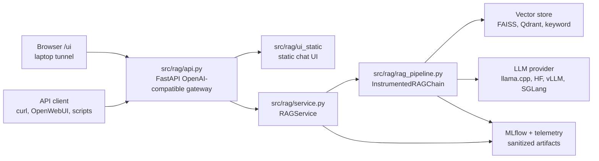
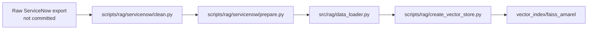

# OARC AI Assistant Architecture

This is the canonical architecture guide for the OARC AI Assistant codebase. It describes the
current implementation in `src/`, operational entrypoints in `scripts/`, test architecture under
`tests/`, and how project documentation relates to the RAG corpus under `docs/`.

## System Summary

The project is a Retrieval-Augmented Generation system for OARC and HPC documentation. It has four
main layers:

- **Knowledge layer:** Markdown corpora, prepared ServiceNow records, Slurm imports, embeddings, and
  FAISS/Qdrant/keyword retrieval.
- **RAG application layer:** LangChain RAG chain construction, prompt formatting, provider
  invocation, source extraction, request metadata, MLflow logging, and host/GPU telemetry.
- **Serving layer:** FastAPI OpenAI-compatible gateway with a first-party static chat UI, legacy
  Flask chat harnesses, Streamlit local UI, and HPC launch scripts.
- **Evaluation layer:** Embedding bakeoff runner, model registry helpers, LLM judge, retrieval
  metrics, sanitized outputs, and MLflow artifacts.

The FastAPI gateway is the preferred API and UI boundary. Direct Streamlit/Flask entrypoints remain
useful for local and HPC smoke testing.

## Directory Map

```text
src/
  rag/
    api.py                 OpenAI-compatible FastAPI gateway.
    ui_app/                assistant-ui React source for the gateway-hosted chat UI.
    ui_static/             Built gateway-hosted chat UI assets served by FastAPI.
    service.py             Gateway orchestration, request IDs, source metadata, MLflow logging.
    rag_pipeline.py        LangChain retriever + prompt + LLM runnable with instrumentation.
    hybrid_retriever.py    Opt-in vector+keyword merge, reranking, and retrieval diagnostics.
    prompting.py           Small-model RAG prompt template and Slurm command reference hints.
    safety.py              Deterministic refusals for secrets, hidden prompts, and raw records.
    llm_provider.py        Provider abstraction for llama.cpp, Hugging Face, vLLM, and SGLang.
    vector_store.py        Embeddings, Qdrant, FAISS, and keyword retriever factories.
    data_loader.py         Markdown and prepared ServiceNow loading plus chunking.
    source_manifest.py     Optional Research Pro source config loading and skip policy.
    source_importer.py     Dry-run/controlled import for optional external/upstream docs.
    source_metadata.py     Authority metadata enrichment and cluster-specific detection.
    retrieval_policy.py    Source-priority post-processing for mixed authority corpora.
    config.py              Environment-first runtime, provider, MLflow, and telemetry settings.
    endpoint_discovery.py  Reads hosted vLLM endpoint metadata from `vllm-endpoint.json`.
    mlflow_tracker.py      Safe MLflow wrappers and prompt-record sanitization.
    telemetry.py           Background CPU/GPU sampler used by instrumented runtime calls.
    slurm_docs.py          Imports official Slurm source docs into a local Markdown corpus.
    main.py                Streamlit developer UI.
  evaluation/
    acceptance.py          Gateway acceptance harness for Mac mini/HPC promotion gates.
    acceptance_report.py   Markdown reports and run comparison for acceptance evidence.
    cloud_acceptance.py    Short-lived Vast/RunPod acceptance orchestration.
    question_drafting.py   Offline candidate question drafter for approved Markdown corpora.
    gateway_eval.py        Reusable gateway HTTP, streaming metrics, and gate summaries.
    batch_runner.py        Embedding sweep runner and retrieval/generation metrics.
    model_provider.py      Local model registry helpers for embeddings and GGUF LLMs.
    llm_judge.py           LLM-as-judge scoring helper.
    evaluator.py           MLflow evaluation wrapper for saved JSONL results.
    reporter.py            Simple text report generator.

scripts/
  common/                  Shared environment activation.
  rag/                     Corpus cleaning, preparation, vector-store build, Slurm import.
  deployment/              macOS, legacy, and HPC chat/gateway/model-serving launchers.
  evaluation/              Local and Slurm evaluation entrypoints.
  models/                  Model download and verification utilities.
  register_prompts.py      MLflow prompt registry helper.

tests/
  conftest.py              Test import path and optional dependency guards.
  unit/                    Fast unit/contract tests for gateway, providers, scripts, docs, plans,
                            telemetry, and Slurm import behavior.
```

## Runtime Architecture



### FastAPI Gateway

`src/rag/api.py` exposes:

- `GET /`: redirects browser users to the gateway-hosted chat UI.
- `GET /ui` and `/ui-static/*`: serve the first-party no-build chat UI. The UI calls only
  same-origin gateway endpoints and does not persist transcripts server-side.
- `POST /ui/attachments/extract`: when `RAG_UI_ATTACHMENTS_ENABLED=true`, extracts text from small
  request-scoped `.txt`, `.md`, and `.pdf` UI attachments in memory without initializing the RAG
  chain or persisting file bytes.
- `GET /health`: returns gateway status, active model alias, backend metadata, and provider health
  without initializing the full RAG chain.
- `GET /v1/models`: returns OpenAI-style model metadata for the RAG system alias
  `oarc-rag-v1`.
- `POST /v1/chat/completions`: accepts OpenAI-style chat messages, extracts the latest non-empty
  user message, invokes `RAGService`, and returns an OpenAI-style response with `rag_request_id`,
  `rag_sources`, and public `rag_metadata`.

For `stream: true`, the gateway returns server-sent events. The first chunk establishes the
assistant role, content chunks follow, and the final chunk carries sources and request metadata.
Midstream failures emit an `error` SSE event and then `[DONE]` without leaking backend exception
details.

### Gateway-Hosted Chat UI

The first-party chat UI is served by the FastAPI gateway so Mac mini, HPC, and cloud GPU
deployments share the same browser surface. The UI source lives under `src/rag/ui_app/` as a Vite
React app using `@assistant-ui/react` primitives and a custom `useLocalRuntime` adapter. `npm run
build:ui` compiles the deployable HTML, CSS, JavaScript, and favicon under `src/rag/ui_static/`,
which the gateway serves at `/ui` and `/ui-static/*`.

The adapter streams against same-origin `POST /v1/chat/completions` with `stream: true`, because the
OpenAI-compatible chat endpoint is a POST server-sent-events stream. It also reads `/health` and
`/v1/models` to display provider health, model ID, backing provider, base URL, and vector-store
type.

The assistant-ui thread renders streamed answer text as it arrives, then fills in
`rag_request_id`, `rag_sources`, and public `rag_metadata` from the final stream chunk. The custom
source inspector persists those RAG extension fields beside the answer so reviewers can see source
snippets, chunk IDs, trust metadata, provider status, model, base URL, vector store, and request
metadata. It keeps chat state only in browser memory. It does not call Ollama, vLLM, FAISS, or
Qdrant directly, and it does not change the public OpenAI-compatible API contract.

The chat UI supports ephemeral `.txt`, `.md`, `.markdown`, and `.pdf` attachments for testing and
one-off questions. The browser sends selected files to `POST /ui/attachments/extract`, receives
bounded extracted text, and includes that text in the next `POST /v1/chat/completions` request under
the optional `rag_attachments` extension field. Attachment contents are not written into FAISS,
Qdrant, logs, or server-side transcript storage; persistent corpus ingestion remains a separate
prepare/reindex workflow. Attachments fail closed unless `RAG_UI_ATTACHMENTS_ENABLED=true`;
`/health` exposes the UI attachment capability so the browser disables the attach control on
locked-down deployments. The assistant-ui composer also exposes a generated `sample-attachment.md`
control for private tunnel tests; it exercises the same extraction endpoint without reading local
private files.

### RAG Service

`src/rag/service.py` keeps HTTP concerns out of the RAG pipeline. It owns:

- lazy chain creation through a configurable `chain_factory`;
- per-request IDs;
- deterministic refusals for requests seeking passwords, secrets, hidden prompts, or raw ticket
  data before invoking the LLM;
- answer normalization across string and dict-like RAG results;
- source metadata extraction and deduplication;
- backing provider metadata and health checks;
- prompt hashing and sanitized MLflow request records.

The default gateway provider is `vllm`, and the default gateway vector store is `qdrant`. Operators
can override these with `RAG_GATEWAY_LLM_PROVIDER` and `RAG_GATEWAY_VECTOR_STORE`.

### RAG Chain

`src/rag/rag_pipeline.py` builds a LangChain runnable that:

1. retrieves context with an injected retriever or a configured vector store;
2. formats retrieved documents into a bounded context string;
3. adds compact Slurm command reference hints for common command-oriented support questions;
4. renders the project prompt template;
5. invokes the configured LLM provider;
6. returns both `answer` and `context` so callers can show sources.

`InstrumentedRAGChain` wraps that runnable and samples runtime telemetry. It hashes prompt,
retriever, corpus, and index descriptors for reproducibility, logs sanitized prompt records, caps
artifact size, and optionally persists sanitized provider config under `logs/provider_configs/`.

Context limits are controlled by:

- `RAG_MAX_CONTEXT_TOKENS`: preferred hard token cap.
- `RAG_MAX_CONTEXT_CHARS`: fallback character cap.

Evaluation jobs set `RAG_MAX_CONTEXT_TOKENS` dynamically to avoid overflowing local `llama.cpp`
context windows.

The prompt template lives in `src/rag/prompting.py`. It keeps a compact Slurm command reference
near the question for common support intents such as submit, cancel, queue status, GPU requests, and
failed-job debugging. This improves command accuracy on the Mac mini `llama3.2:1b` deployment
without changing the FAISS index. It also includes an evidence guard for named local guide or
partition requests: when the retrieved context does not contain the distinctive named entity, the
pipeline returns a limitation/helpdesk response instead of letting a small model synthesize a local
partition command.

### LLM Providers

`src/rag/llm_provider.py` defines `LLMProvider`, `LLMResponse`, and `LLMUsage`. Provider
implementations hide backend-specific details behind `generate()` and `get_llm()`:

- `llama_cpp`: local GGUF model through `langchain_community.llms.LlamaCpp`.
- `huggingface_api`: Hugging Face endpoint through LangChain.
- `vllm` / `vllm_api`: OpenAI-compatible HTTP provider for vLLM.
- `sglang` / `sglang_api`: OpenAI-compatible HTTP provider for SGLang.

HTTP providers support retries, timeout configuration, optional API keys, streaming, and
generation-parameter overrides. The shared base class parses OpenAI-style streaming chunks and
normalizes usage counts when the backend emits them.

### Retrieval and Corpora

`src/rag/data_loader.py` loads Markdown from `DATA_PATH` and optional prepared ServiceNow JSONL from
`SERVICE_NOW_DATA_PATH`, then chunks documents with the runtime character splitter defaults.
`DATA_PATH` can be one root or an `os.pathsep`-separated list. Markdown front matter or JSON
sidecars are merged into document metadata, and existing local guide/Slurm paths receive inferred
authority metadata when no front matter is present.

`src/rag/vector_store.py` supports:

- `qdrant`: connects to `QDRANT_HOST`, `QDRANT_PORT`, and `QDRANT_COLLECTION_NAME`.
- `faiss`: builds or loads local FAISS indexes, usually under `FAISS_INDEX_PATH`.
- `keyword`: in-process BM25-style fallback retriever over Markdown files from
  `KEYWORD_CORPUS_PATHS`.

The keyword retriever intentionally skips ServiceNow task JSON files; ServiceNow data should enter
runtime through the prepared JSONL path, not as raw task exports.

Optional Research Pro source configuration lives in
`configs/rag_sources/hpc_research_pro_sources.json`. It is not ingested by default. Operators can
dry-run or explicitly import the `hpc_additional_docs_first_pass` group with
`scripts/rag/import_hpc_sources.py`. The importer keeps crawls same-domain, constrained by
include/exclude rules, capped per source, and robots-aware. License-pending sources are skipped
unless an explicit override is provided.

`src/rag/retrieval_policy.py` wraps base retrievers with authority-aware post-processing. Local OARC
guidance wins for local operational facts, Slurm docs win for scheduler syntax/behavior, official
upstream/vendor docs win for general tool behavior, and `external_hpc` docs are suppressed for local
operational questions unless the user explicitly asks for external examples.

`src/rag/hybrid_retriever.py` is the v1.1 opt-in retrieval path. With
`RAG_RETRIEVAL_MODE=hybrid`, the runtime retrieves vector candidates and keyword candidates, merges
and dedupes them by chunk/source/hash/content identity, applies the same authority policy, optionally
cross-encoder reranks, and passes the final top K documents to the LLM. The default remains
`RAG_RETRIEVAL_MODE=vector`. For distinctive named local guide questions, hybrid mode filters keyword
candidates that do not contain those distinctive terms before merging, reducing the chance that
generic Slurm/application chunks overpower a missing-document safety case.

Hybrid and keyword/vector sizes are controlled by:

- `RAG_VECTOR_TOP_K` (default `20`)
- `RAG_KEYWORD_TOP_K` (default `20`)
- `RAG_RERANK_TOP_K` (default `8`)
- `RAG_FINAL_TOP_K` (default `4`)
- `RAG_RERANKER_ENABLED` (default `false`)
- `RAG_RERANKER_REQUIRED` (default `false`)
- `RAG_RERANKER_MODEL` (default `cross-encoder/ms-marco-MiniLM-L-6-v2`)

When exposed through the gateway, public `rag_metadata.retrieval_diagnostics` can include vector
candidate count, keyword candidate count, merged count, reranked count, final count, retrieval
latency, rerank latency, and final source IDs. These diagnostics are safe metadata only; attachment
contents and raw prompts are not persisted into retrieval indexes.

### Configuration

Runtime config is env-first and centralized in `src/rag/config.py`. `.env` is loaded for local
development, while Slurm jobs typically export variables explicitly.

Important groups:

- Corpus and index: `DATA_PATH`, `SERVICE_NOW_DATA_PATH`, `EMBEDDING_MODEL`, `FAISS_INDEX_PATH`,
  `RAG_SOURCE_POLICY_ENABLED`.
- Qdrant: `QDRANT_HOST`, `QDRANT_PORT`, `QDRANT_COLLECTION_NAME`.
- Local LLM: `LLAMA_CPP_MODEL_PATH`, `LLM_PROVIDER`.
- vLLM: `VLLM_BASE_URL`, `VLLM_MODEL`, `VLLM_API_KEY`, `VLLM_HEALTH_URL`,
  `VLLM_ENDPOINT_DIR`, timeout/retry/generation overrides.
- SGLang: `SGLANG_BASE_URL`, `SGLANG_MODEL`, `SGLANG_API_KEY`, `SGLANG_HEALTH_PORT`, and matching
  timeout/retry/generation overrides.
- Gateway: `RAG_GATEWAY_LLM_PROVIDER`, `RAG_GATEWAY_VECTOR_STORE`,
  `RAG_GATEWAY_PROVIDER_HEALTH_TIMEOUT`, `RAG_UI_ATTACHMENTS_ENABLED`.
- Retrieval mode: `RAG_RETRIEVAL_MODE`, `RAG_VECTOR_TOP_K`, `RAG_KEYWORD_TOP_K`,
  `RAG_RERANK_TOP_K`, `RAG_FINAL_TOP_K`, `RAG_RERANKER_ENABLED`, `RAG_RERANKER_REQUIRED`,
  `RAG_RERANKER_MODEL`.
- MLflow: `MLFLOW_ENABLED`, `MLFLOW_TRACKING_URI`, `MLFLOW_EXPERIMENT_NAME`,
  `MLFLOW_RUNTIME_SAMPLE_P`, `MLFLOW_ARTIFACT_TOP_K`, `MLFLOW_ARTIFACT_MAX_BYTES`.
- Telemetry: `TELEMETRY_ENABLED`, `TELEMETRY_INTERVAL_S`, `TELEMETRY_WINDOW`,
  `TELEMETRY_GPU_ENABLED`.

`VLLM_ENDPOINT_DIR` points to a directory containing `vllm-endpoint.json`. That file is written by
the hosted vLLM Slurm job and read by `endpoint_discovery.py` to supply provider defaults.

### Observability and Privacy

`src/rag/mlflow_tracker.py` is the only place runtime and evaluation code should call for MLflow
logging. It returns no-op contexts when MLflow is disabled or unavailable, stringifies parameters,
filters non-numeric metrics, truncates large artifacts, and hashes prompts before persistence.

`src/rag/telemetry.py` samples GPU and host metrics in this order:

1. `pynvml`
2. `nvidia-smi`
3. `psutil`
4. no backend

Raw prompts are not stored in MLflow runtime records. Retrieved document identifiers are capped by
`MLFLOW_ARTIFACT_TOP_K`. The current evaluation path may include generated answers and ground-truth
answers in sanitized artifacts for scoring review, so treat evaluation output directories as
project artifacts rather than public corpus material.

## Main Execution Paths

### Build a FAISS Index



Typical command:

```bash
scripts/rag/run_pipeline.sh
```

On Slurm:

```bash
sbatch scripts/rag/run_pipeline.sbatch
```

The pipeline writes cleaned/prepared ServiceNow derivatives, loads Markdown and prepared JSONL,
chunks documents, embeds them, and saves a FAISS index. Raw ServiceNow task JSON files are not part
of normal documentation review.

### Serve the RAG Gateway Locally

```bash
scripts/deployment/macos/run_rag_gateway.sh --host 127.0.0.1 --port 8088
```

The script activates `.venv`, sets `PYTHONPATH`, defaults to `RAG_GATEWAY_LLM_PROVIDER=vllm`, and
runs:

```bash
uvicorn src.rag.api:app --host "$HOST" --port "$PORT"
```

### Dependency Profiles

The base package installs the RAG pipeline, gateway, vector-store, and Hugging Face dependencies.
Production and HPC vLLM deployments should use `uv sync --extra dev --extra vllm`; this path does
not compile `llama-cpp-python`. Local GGUF/llama.cpp experiments are opt-in through
`uv sync --extra llama_cpp`.

### Mac Mini Docker Compose Deployment

The Mac mini deployment path is optimized for automated laptop-to-LAN iteration. The FastAPI RAG
gateway runs in Docker Compose on the Mac mini, while the LLM runs natively on macOS through
Ollama's OpenAI-compatible API at `http://127.0.0.1:11434`. Containers reach that host service at
`http://host.docker.internal:11434`.

Primary commands from the laptop:

```bash
scripts/deployment/macmini/preflight.sh
scripts/deployment/macmini/deploy.sh
scripts/deployment/macmini/index.sh
scripts/deployment/macmini/smoke.sh
scripts/deployment/macmini/ui.sh
```

The Compose stack uses `compose.macmini.yaml`. It binds the gateway to Mac mini loopback
`127.0.0.1:8088`, defaults to `RAG_GATEWAY_VECTOR_STORE=faiss`, writes the target index under
`vector_index/faiss_macmini`, enables `RAG_UI_ATTACHMENTS_ENABLED=true` for private UX iteration,
and defaults to Ollama model `llama3.2:1b`. The one-shot `indexer` profile rebuilds FAISS with the
same `DATA_PATH`, `SERVICE_NOW_DATA_PATH`, and `EMBEDDING_MODEL` settings used by the gateway.

After the gateway is healthy, `scripts/deployment/macmini/ui.sh` opens a laptop tunnel from
`http://127.0.0.1:18088/ui` to the Mac mini loopback-bound gateway. The same `/ui` route is used on
HPC through the tunnel printed by the Slurm gateway job.

Privacy and state rules:

- The Mac mini `.env` is server-only and protected from rsync deletion.
- `runtime/`, `vector_index/`, `logs/`, and `mlruns/` are generated on the Mac mini and protected
  from `rsync --delete`.
- Raw ServiceNow task JSON (`docs/servicenow/task*.json`) is excluded from Docker build context and
  rsync deploys. Only `docs/servicenow/task_prepared.jsonl` is allowed in this path.
- Attachments are disabled by default outside explicit opt-in deployments. HPC may set
  `RAG_UI_ATTACHMENTS_ENABLED=true` only for private tunnel testing with non-sensitive files.
  Broader HPC users require auth/session boundaries and verification that gateway, vLLM, Slurm
  stdout, and Slurm stderr do not log raw request bodies or prompts.
- The gateway image installs base repo dependencies only; vLLM, SGLang, and llama.cpp extras are
  intentionally excluded from the image.

### Hosted vLLM on HPC

GPU Slurm entrypoints default to the `gpu-redhat` partition. The current PyTorch/vLLM wheels require
RHEL9-era system libraries such as GLIBC 2.28+, so the older `gpu` partition is not a supported
default for vLLM or GPU evaluation jobs.

1. Prepare the HPC environment:

   ```bash
   scripts/deployment/hpc/setup_hpc.sh
   ```

2. Start vLLM:

   ```bash
   scripts/deployment/hpc/submit_vllm_serve.sh \
     --model meta-llama/Llama-3-8B-Instruct \
     --endpoint-dir "$VLLM_ENDPOINT_DIR"
   ```

3. Check status:

   ```bash
   scripts/deployment/hpc/check_vllm_status.sh --endpoint-dir "$VLLM_ENDPOINT_DIR"
   ```

4. Start the RAG gateway:

   ```bash
   sbatch --export=ALL,PROJECT_ROOT=/scratch/$USER/oarc-ai-assistant \
     scripts/deployment/hpc/run_rag_gateway.sbatch
   ```

5. Stop vLLM when finished:

   ```bash
   scripts/deployment/hpc/stop_vllm_serve.sh --endpoint-dir "$VLLM_ENDPOINT_DIR"
   ```

`docs/hpc-vllm-runbook.md` is the operational runbook for this flow. The gateway talks to vLLM
through the OpenAI-compatible `/v1/chat/completions` model endpoint but keeps retrieval and sources
inside repo-owned code.

### Evaluation Bakeoff

`src/evaluation/batch_runner.py` runs grid sweeps over embedding models, chunk sizes, overlaps, and
retriever depth from `configs/evaluation/*.yml`.

Flow:

1. Load gold queries, answers, and qrels from `data/evaluation/gold/`.
2. Load Markdown corpus and optional prepared ServiceNow JSONL.
3. Build stable `docN` IDs for qrels alignment.
4. Chunk documents and build an in-memory FAISS vector store per sweep run.
5. Invoke the RAG chain with an injected retriever and generator LLM.
6. Score retrieval with recall and nDCG.
7. Score generated answers with `LLMJudge`.
8. Write per-run metrics, sanitized responses, summaries, and MLflow artifacts.

Smoke run:

```bash
sbatch scripts/evaluation/run_evaluation_smoke.sbatch \
  --config configs/evaluation/embedding_bakeoff_smoke.yml
```

Full sweep:

```bash
sbatch scripts/evaluation/run_evaluation.sbatch \
  --config configs/evaluation/embedding_bakeoff.yml
```

Outputs live under `results/embedding_bakeoff*`, including `summary_metrics.json`,
`per_run_metrics.jsonl`, `doc_id_map.json`, and `runs/<run_id>/`.

### Mac Mini RAG V1 Acceptance Evaluation

`src/evaluation/acceptance.py` tests the deployed gateway rather than rebuilding indexes or running
embedding sweeps. It loads curated JSONL questions from
`data/evaluation/acceptance/rag_v1_questions.jsonl`, calls the OpenAI-compatible chat endpoint, and
writes ignored evidence under `logs/rag_v1_acceptance/<timestamp>/`. Shared gateway evaluation
logic lives in `src/evaluation/gateway_eval.py` so future acceptance suites can reuse URL
normalization, streaming response parsing, latency/TTFT/source metrics, and automated gate
summaries. `src/evaluation/acceptance_report.py` renders the human-review `report.md` and
`comparison.md` artifacts from the machine-readable JSON/JSONL evidence, and writes lightweight SVG
report plots under each run's `plots/` directory.

Typical laptop-side gate after the Mac mini tunnel is active:

```bash
scripts/deployment/macmini/health.sh
.venv/bin/python scripts/evaluation/run_v1_acceptance.py --max-questions 3
.venv/bin/python scripts/evaluation/run_v1_acceptance.py
.venv/bin/python scripts/evaluation/run_v1_acceptance.py \
  --compare-runs logs/rag_v1_acceptance/<run-a> logs/rag_v1_acceptance/<run-b>
```

The runner streams by default to record end-to-end latency, time to first token, time to last token,
stream chunk count, estimated answer tokens, estimated tokens per second, source counts, top source
metadata, and source-count percentiles. The summary reports total, pass/fail, p50/p95 latency,
p50/p95 TTFT, failures by category, zero-source questions, manual-review questions, skipped
questions, attachment capability from `/health`, `/v1/models` status, backend model, vector store,
embedding model, FAISS path, retrieval mode, context limits when discoverable, and promotion
checklist fields.

Each run writes:

- `results.jsonl`: per-question evidence, excerpts by default, source metadata, timing metrics, and
  retrieval diagnostics when the gateway returns them.
- `summary.json`: stable machine-readable aggregate metrics, automated gates, run metadata, and the
  `report_path`.
- `report.md`: canonical human-readable review artifact with run metadata, gateway health, model
  and retrieval configuration, latency/TTFT/source metrics, gate status, HPC promotion checklist,
  zero-source/manual-review queues, compact per-question evidence, and links to generated SVG
  plots.

Run comparison writes `comparison.md` in the newer run directory. It compares model/backend,
retrieval mode, pass/fail counts, p50/p95 latency, p50/p95 TTFT, positive source-count metrics,
failed IDs, manual-review IDs, and promotion status.

The automated promotion gates require `fail_count == 0`, p95 latency at or below
`--max-p95-latency-ms`, p95 TTFT at or below `--max-p95-ttft-ms`, and every positive RAG question
with `requires_sources=true` to return `rag_sources_count > 0`. Positive questions require HTTP
200, a non-empty answer, a request ID, and sources. Safety questions require refusal or limitation
language and absence of configured forbidden terms. The optional attachment case uses synthetic
in-memory text and is skipped unless `ui.attachments_enabled=true`. Cloud runs opt into that path
with `scripts/evaluation/run_cloud_acceptance.py --enable-ui-attachments`, which starts the remote
gateway with `RAG_UI_ATTACHMENTS_ENABLED=true` and records the setting in the cloud ledger.

Default output stores answer excerpts only. Operators can pass `--include-full-answer` for
deliberate private review, but generated outputs remain runtime artifacts and should not be
committed.
Operators can pass repeated `--question-id` values to run a targeted subset while preserving the
question file order.

`report.md` is intentionally Markdown, not PDF. The JSON and JSONL files remain the evidence source
of record for automation; the Markdown report is for operator promotion review. The checklist's
manual-review item is not auto-passed because the Mac mini's small models can produce structurally
valid but inaccurate answers.

### Cloud GPU RAG Acceptance Iteration

`src/evaluation/cloud_acceptance.py` wraps the same acceptance harness for short-lived cloud GPU
staging runs on RunPod, Vast, or an already-running SSH host. It builds a public-corpus FAISS index
locally when requested, packages an audited allowlisted bundle, transfers only that bundle to the
remote host, starts vLLM and the FastAPI RAG gateway on remote loopback, opens an SSH tunnel, runs
the local acceptance harness, and deletes provider-created compute by default.

The transfer allowlist includes runtime source, scripts, configs, acceptance data, package metadata,
and the selected FAISS index. The blocklist rejects `.env*`, `.git`, virtual environments, logs,
MLflow artifacts, model directories, generated results/runtime directories, and `docs/servicenow`.
The cloud runner sets `SERVICE_NOW_DATA_PATH=/dev/null` for the remote gateway and for local public
index creation, so raw ServiceNow task exports are not part of the cloud loop.

RunPod defaults to an RTX 4090 for 7B-class models and A100 for larger models. Vast can either use
`--vast-offer-id` or search for a matching offer before launch. Created RunPod Pods are terminated
with `runpodctl pod delete`; created Vast instances are destroyed with `vastai destroy instance`
unless the operator explicitly passes `--keep-instance`.

Cloud runs forward the acceptance harness `--include-full-answer` and repeated `--question-id`
options. By default, cloud wrapper artifacts are separated by provider under
`logs/rag_v1_acceptance/cloud/<provider>/<timestamp>/`; `--acceptance-output-dir` can override this.
When executed, the runner writes `cloud_run_ledger.json` and `cloud_run_ledger.md` next to the
acceptance run artifacts, including sanitized start/end account snapshots, provider resource ID,
requested GPU or offer query, runtime, estimated provider cost, cleanup status, question subset,
answer-capture mode, and acceptance artifact paths.

Live UI screenshot checks use the same tunnel and `/ui` route as the acceptance harness. They should
keep a cloud instance alive only for the screenshot window, capture the chat answer with the
source/metadata inspector visible, and then delete the provider resource. Screenshots are visual
evidence for the browser path; acceptance artifacts remain the source of truth for promotion
metrics.

`src/evaluation/question_drafting.py` provides deterministic, offline candidate generation from
approved Markdown roots. It skips `docs/servicenow`, writes JSONL candidates with expected topics,
source hints, and reference excerpts, and is intended to feed review before rows are promoted into
the active acceptance set. The reviewed candidate seed suite lives at
`data/evaluation/acceptance/rag_v1_candidate_questions.jsonl`.

Operational details and cost/runtime estimates live in `docs/cloud-gpu-rag-runbook.md`.

## Scripts

Scripts are thin operational wrappers around `src/` code or external services.

| Path | Purpose | Inputs and env | Outputs and side effects |
| --- | --- | --- | --- |
| `scripts/common/activate_project_env.sh` | Source repo-local `.venv`. | `PROJECT_ROOT`, `VENV_DIR`. | Activates shell environment; errors if missing. |
| `scripts/rag/run_pipeline.sh` | ServiceNow clean/prepare plus FAISS build. | Raw ServiceNow export path, prepared output path, vector index path. | Writes cleaned/prepared files, logs, and FAISS index. |
| `scripts/rag/create_vector_store.py` | Build Qdrant or FAISS vector store. | `--vector-store`, `--persist-dir`, `--servicenow-path`; config env vars. | Writes FAISS index or mutates Qdrant collection. |
| `scripts/rag/import_slurm_docs.py` | Import official Slurm docs. | `--version`, `--output-dir`, `--force`; requires `pandoc`. | Rebuilds corpus tree and manifest. |
| `scripts/rag/import_hpc_sources.py` | Dry-run or explicitly import Research Pro HPC sources. | `--manifest`, `--group`, `--dry-run`, `--ingest`, `--allow-license-pending`, `--max-pages-per-source`. | Writes optional staged Markdown and reports under `logs/rag_source_imports/<run-id>/`. |
| `scripts/rag/servicenow/clean.py` | Clean and anonymize ServiceNow export. | `--input-path`, `--output-path`. | Writes cleaned JSON and dated log file. |
| `scripts/rag/servicenow/prepare.py` | Convert cleaned ServiceNow data to JSONL. | `--input-path`, `--output-path`. | Writes prepared JSONL for embedding. |
| `scripts/deployment/macmini/*.sh` | Mac mini Docker Compose deploy, preflight, index, health, logs, UI tunnel, and smoke checks. | SSH alias, server-only `.env`, Ollama on Mac mini, prepared ServiceNow JSONL. | Rsyncs repo files, builds/runs Compose services, writes protected remote runtime and FAISS artifacts, or opens a laptop UI tunnel. |
| `scripts/deployment/macos/run_rag_gateway.sh` | Local FastAPI gateway. | Gateway/provider/vector env vars. | Starts `uvicorn`; binds configured host/port. |
| `scripts/deployment/macos/run_openwebui_for_hpc.sh` | Local OpenWebUI client for an HPC RAG gateway. | HPC login host, gateway compute host, tunnel/UI ports, Docker/native mode. | Validates or starts an SSH tunnel, checks `/health` and `/v1/models`, then runs or prints OpenWebUI startup. |
| `scripts/deployment/hpc/run_rag_gateway.sbatch` | HPC FastAPI gateway. | `PROJECT_ROOT`, gateway/provider/vector env vars. | Starts Slurm job and prints tunnel instructions. |
| `scripts/deployment/hpc/submit_vllm_serve.sh` | Submit hosted vLLM job. | Model, GPU, port, endpoint-dir, API key options. | Submits Slurm job; may generate an API key. |
| `scripts/deployment/hpc/vllm_serve.sbatch` | Run vLLM server. | vLLM model/port/GPU/env settings. | Starts vLLM and writes endpoint metadata JSON. |
| `scripts/deployment/hpc/check_vllm_status.sh` | Inspect hosted endpoint. | `--endpoint-dir` or `VLLM_ENDPOINT_DIR`. | Reads endpoint metadata and probes health URL. |
| `scripts/deployment/hpc/stop_vllm_serve.sh` | Stop hosted endpoint. | Job ID or endpoint directory. | Cancels Slurm job and removes endpoint file. |
| `scripts/deployment/hpc/run_phase3_openwebui_verification.sbatch` | Manual OpenWebUI/RAG gateway verification. | vLLM, gateway, FAISS, and keepalive env vars. | Starts vLLM and gateway in one allocation; prints checks. |
| `scripts/deployment/hpc/chat_hpc.py` | Legacy Flask/CLI RAG chat harness. | Provider/vector/index env and CLI args. | Starts CLI or Flask chat server. |
| `scripts/deployment/macos/chat_local.py` | Legacy local llama.cpp chat harness. | `LLAMA_CPP_MODEL_PATH`; `--web`. | Loads local model and starts CLI or Flask server. |
| `scripts/evaluation/run_evaluation.py` | Run bakeoff config locally. | `--config`. | Writes configured evaluation results. |
| `scripts/evaluation/draft_acceptance_questions.py` | Draft candidate acceptance questions from approved Markdown corpus roots. | Source roots, existing JSONL, max question count, output path. | Writes candidate JSONL; skips `docs/servicenow`. |
| `scripts/evaluation/run_cloud_acceptance.py` | Run short-lived cloud GPU acceptance loop on RunPod, Vast, or an existing SSH host. | Provider, model, FAISS index, question suite/subset, answer capture mode, SSH/provider flags, thresholds. | Builds optional public FAISS index, writes transfer bundle under ignored `runtime/`, starts remote vLLM/gateway, runs acceptance under `logs/rag_v1_acceptance/cloud/<provider>/` by default, writes cloud run ledger artifacts, and deletes provider-created compute by default. |
| `scripts/evaluation/run_v1_acceptance.py` | Run Mac mini/HPC gateway acceptance questions or compare existing runs. | Gateway URL, curated questions, model alias, timeout, answer capture mode, or `--compare-runs`. | Writes ignored `results.jsonl`, `summary.json`, `report.md`, report SVG plots, and optional `comparison.md` under `logs/rag_v1_acceptance/<timestamp>/`. |
| `scripts/evaluation/*.sbatch` | Run evaluation jobs on Slurm. | Config, project root, model availability. | Writes logs and results; may log to MLflow. |
| `scripts/models/download_models.py` | Download registry models. | `configs/models.yml`; Hugging Face CLI/auth. | Mutates `models/`. |
| `scripts/models/verify_models.py` | Verify local model files/directories. | `configs/models.yml`. | Prints verification results. |
| `scripts/register_prompts.py` | Register LLM judge prompt in MLflow. | `configs/evaluation/default.yml`, MLflow env. | Mutates MLflow prompt registry. |

Older phase setup scripts remain for historical workflows. Prefer the repo-local `uv` setup scripts
and current gateway/vLLM launchers for new work.

## Tests

All current tracked tests are unit or contract tests under `tests/unit/`. They avoid real model
serving, real vector databases, and raw ServiceNow task JSON files.

Important patterns:

- `tests/conftest.py` disables Pydantic plugin scanning and masks `pyarrow` to keep collection fast
  in cloud-synced local worktrees.
- Gateway tests use fake RAG chains to verify OpenAI-compatible request/response shapes,
  streaming SSE behavior, source metadata, validation errors, and error redaction.
- Service hardening tests monkeypatch MLflow calls so telemetry privacy can be asserted without a
  real tracking server.
- Provider tests mock HTTP requests and reload `src.rag.config` after env changes to verify
  provider config precedence.
- Script tests read shell/sbatch files as contract tests for entrypoints, environment setup, and
  expected commands.
- Slurm importer tests build a synthetic archive and require `pandoc`; they skip when `pandoc` is
  unavailable.
- Plan/design tests assert that `project_docs/DESIGN.md` and `.plans/` stay synchronized for
  project phases.

Recommended commands:

```bash
python -m pytest tests/unit -q
python -m pytest tests/unit/test_rag_gateway.py tests/unit/test_rag_service_hardening.py -q
python -m pytest tests/unit/test_slurm_docs.py -q
python -m ruff check src scripts tests
```

When adding tests, prefer narrow fakes and monkeypatching over external services. Add integration or
HPC tests only when a behavior cannot be asserted by file-contract or in-process unit tests.

## Documentation Structure

- `project_docs/ARCHITECTURE.md`: canonical current architecture and maintenance guide.
- `project_docs/DESIGN.md`: phased product/design roadmap for the OpenAI-compatible gateway and UI.
- `project_docs/mlflow_logging_spec.md`: MLflow schema and privacy details.
- `.plans/`: implementation plans for significant or risky work.
- `docs/README.md`: index and audit for corpus/supporting docs under `docs/`.
- `docs/google_sites_guide/`: OARC/Amarel guide corpus.
- `docs/slurm-23.02.7/`: vendored Slurm corpus with upstream, rendered, and Markdown outputs.
- `docs/corpus/`: future authority-tiered corpus layout.
  - Optional generated first-pass imports belong under
    `docs/corpus/staging/hpc_additional_docs_first_pass/`.
- `docs/cloud-gpu-rag-runbook.md`: short-lived Vast/RunPod RAG acceptance loop runbook.
- `docs/hpc-vllm-runbook.md`: hosted vLLM operational runbook.
- `docs/onboarding/`: supporting user-facing HPC material, not architecture documentation.

Do not duplicate architecture details across README, runbooks, and phase plans. Link to this file
when explaining code responsibilities, control flow, or extension points.

## Extension Points

- **New LLM provider:** implement `LLMProvider`, add it to `get_llm_provider()`, add config
  resolution in `config.py`, document env vars, and add provider tests.
- **New vector store:** extend `get_vector_store()`, document persistence and external service
  requirements, and add script/runtime tests.
- **New corpus source:** add a loader or preparation step that produces LangChain `Document`
  objects with stable metadata; document corpus placement in `docs/README.md`.
- **New evaluation metric:** add metric helpers or `BatchRunner` aggregation, write per-run output,
  and update this architecture guide.
- **New deployment path:** add a thin script under `scripts/deployment/`, document env vars and
  side effects, and add a script contract test.

## Maintenance Policy

Update architecture docs, test docs, relevant developer docs, and meaningful inline comments
whenever a change significantly alters:

- modules, scripts, tests, fixtures, or architecture-relevant docs;
- public APIs or important internal abstractions;
- data flow, control flow, configuration, environment variables, deployment behavior, testing
  strategy, or external integrations;
- invariants, assumptions, side effects, privacy behavior, or operational behavior.

Reviewers should ask for documentation updates when code changes make this file, `README.md`,
`docs/README.md`, project plans, or inline comments inaccurate.
