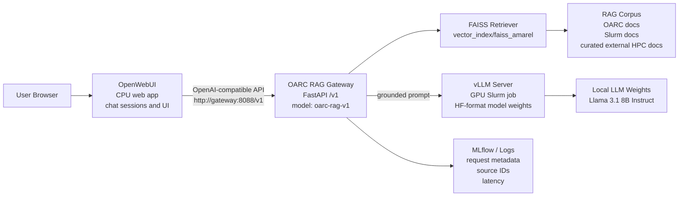
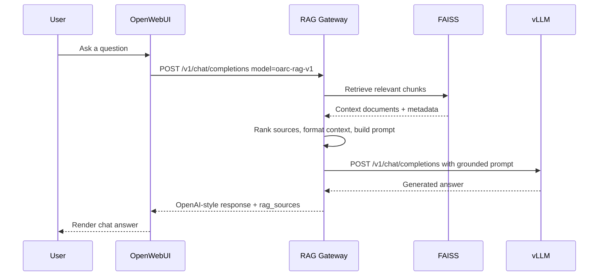
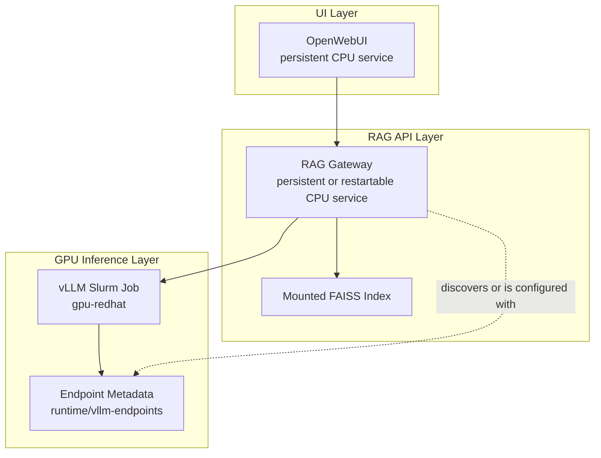

# HPC RAG OpenWebUI Architecture

This document describes the intended deployment architecture for the OARC RAG assistant on HPC,
with OpenWebUI as a separate chat UI client and vLLM as the GPU-backed model server.

## Summary

OpenWebUI should be separated from the GPU job that runs vLLM. OpenWebUI is a web application and
does not need a GPU. vLLM is the expensive GPU service. The RAG gateway sits between them so users
get retrieval, source metadata, and a stable OpenAI-compatible API instead of calling raw vLLM.

```text
OpenWebUI:  browser chat UI, CPU/web process
RAG gateway: OpenAI-compatible API, retrieval, prompt assembly, source metadata
FAISS:      vector index loaded by the gateway
vLLM:       GPU model server
```

## Architecture



## Request Flow



## Component Responsibilities

- **OpenWebUI**
  - Runs on: laptop, workstation, CPU node, or app server.
  - Needs GPU: no.
  - Responsibility: chat UI, user sessions, and model selector.
- **RAG gateway**
  - Runs on: CPU node, service host, or the same allocation for a POC.
  - Needs GPU: no, except embeddings may use GPU if one is visible.
  - Responsibility: OpenAI-compatible API, retrieval, prompt assembly, and sources.
- **FAISS index**
  - Runs on: disk under the project workspace.
  - Needs GPU: no.
  - Responsibility: local vector search artifact.
- **vLLM**
  - Runs on: GPU Slurm job on `gpu-redhat`.
  - Needs GPU: yes.
  - Responsibility: high-throughput model inference.
- **Model weights**
  - Runs on: shared scratch or project storage.
  - Needs GPU: no by itself.
  - Responsibility: HF-format weights loaded by vLLM.

## POC Deployment

The Phase 3 proof of concept used a single Slurm job to start both vLLM and the RAG gateway:

```text
Mac browser/client
  -> SSH tunnel to gpu022:8088
  -> RAG gateway in Phase 3 Slurm job
  -> FAISS index on /scratch
  -> vLLM in the same GPU allocation
```

This validated the backend/API path:

- vLLM started on `gpu-redhat`.
- RAG gateway loaded `vector_index/faiss_amarel`.
- Gateway exposed `oarc-rag-v1`.
- `/health`, `/v1/models`, and `/v1/chat/completions` passed.
- Laptop SSH tunnel reached the live gateway.
- Direct responses included `rag_sources`.

OpenWebUI itself was not launched by the Slurm job. It remains a separate UI-client task.

## Recommended Production Shape

For a more durable deployment, split lifecycle and resource ownership:



Recommended separation:

- Run OpenWebUI as a CPU/web service, not inside the GPU Slurm job.
- Run the RAG gateway as the stable API boundary that OpenWebUI calls.
- Run vLLM as an independently managed GPU service.
- Keep raw vLLM access only for bypass/debug tests.
- Point users and UI clients at the RAG gateway, not at raw vLLM.

## Endpoint Contract

OpenWebUI should be configured against the RAG gateway:

```text
Base URL: http://<gateway-host>:8088/v1
Model:    oarc-rag-v1
API key:  placeholder or configured gateway token
```

For the current laptop tunnel POC:

```text
Base URL: http://127.0.0.1:8088/v1
Model:    oarc-rag-v1
```

If OpenWebUI runs in Docker Desktop on the laptop, the provider URL should usually be:

```text
Base URL: http://host.docker.internal:8088/v1
Model:    oarc-rag-v1
```

Raw vLLM is not the user-facing RAG endpoint:

```text
http://<gpu-node>:8000/v1
```

Calling raw vLLM bypasses FAISS retrieval, RAG prompt construction, source metadata, and gateway
telemetry.

## Phase 3b Local UI Workflow

Operators can use `scripts/deployment/macos/run_openwebui_for_hpc.sh` from the laptop after the HPC
RAG gateway is already running. The script is intentionally a local UI-client helper: it validates
or starts the SSH tunnel, checks the gateway through the tunnel, and runs OpenWebUI in Docker mode
or prints native/Docker startup commands.

Example:

```bash
scripts/deployment/macos/run_openwebui_for_hpc.sh \
  --login-host ep523@amarel-new \
  --gateway-compute-host gpu022.amarel.rutgers.edu \
  --gateway-port 8088 \
  --local-gateway-port 8088 \
  --openwebui-port 3000 \
  --mode docker
```

The OpenWebUI provider values remain:

```text
Native/local Base URL:    http://127.0.0.1:8088/v1
Docker Desktop Base URL: http://host.docker.internal:8088/v1
Model:                   oarc-rag-v1
API key:                 dummy unless the gateway is later secured
```

This workflow does not belong inside the GPU Slurm job. The Slurm allocation should keep running
vLLM and the RAG gateway; OpenWebUI should stay a separate CPU/web client.

## Why This Separation Matters

- OpenWebUI does not need GPU resources.
- UI uptime should not burn GPU allocation time.
- vLLM can be queued, restarted, resized, or moved without changing the user-facing UI contract.
- The RAG gateway preserves source metadata and a stable model alias.
- The UI remains replaceable by Chainlit, a custom React frontend, curl, or another
  OpenAI-compatible client.
- Production auth, logging, and user-session behavior can be handled outside the GPU process.

## Current Artifacts

- Phase 3 outcome report: `project_docs/phase3_hpc_openwebui_report.md`
- General architecture guide: `project_docs/ARCHITECTURE.md`
- Design roadmap: `project_docs/DESIGN.md`
- vLLM runbook: `docs/hpc-vllm-runbook.md`
- Local OpenWebUI helper: `scripts/deployment/macos/run_openwebui_for_hpc.sh`
- Combined POC launcher: `scripts/deployment/hpc/run_phase3_openwebui_verification.sbatch`
- Standalone vLLM launcher: `scripts/deployment/hpc/submit_vllm_serve.sh`
- Gateway launcher: `scripts/deployment/hpc/run_rag_gateway.sbatch`

## Next Phase Boundary

Phase 3 is complete for the HPC backend/API path. The next work should be split into:

- **Phase 3b: Demo UI Client Setup**: the local operator launcher now starts or validates the
  tunnel, runs or instructs OpenWebUI startup, and prints the provider settings for the RAG gateway.
  Live UI prompt validation remains pending the next active HPC gateway.
- **Phase 5: Quality and Ops Readiness**: improve retrieval quality, add regression questions, and
  harden runtime operations.

Do not treat OpenWebUI installation as a blocker for the validated vLLM plus RAG backend. It is a
separate UI integration task.
